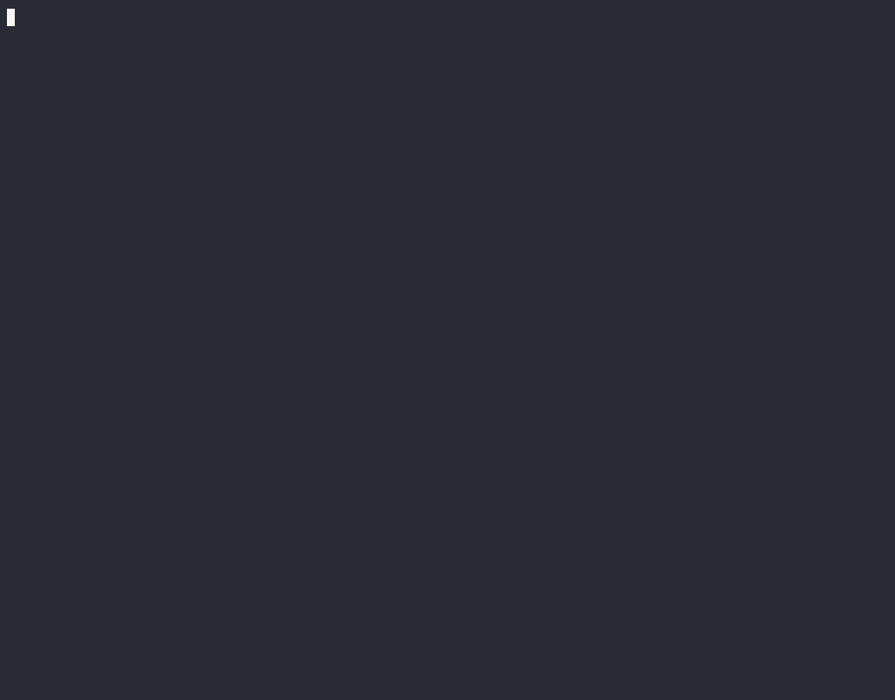

# tailworks

**Run Cloudflare-style Workers and Durable Objects on your own machines, on
your Tailscale tailnet.** Every workload, and every Durable Object, is its own
tailnet node with its own name, tags and grants. Callers are identified by
their tailnet identity, not tokens; your tailnet policy decides who can call
what, and what each object can reach.

[](docs/demo.md)

It runs your code on [workerd](https://github.com/cloudflare/workerd) on
macOS (Apple silicon) or Linux. Agents SDK agents, MCP servers and Vercel AI
SDK agents run unmodified. What that covers is measured against the upstream
projects' own examples, one row each, failures included:
[Agents SDK](docs/COMPAT.md#upstream-examples-agents-sdk),
[Vercel AI SDK](docs/COMPAT.md#upstream-examples-vercel-ai-sdk),
[mcp-handler](docs/COMPAT.md#upstream-examples-mcp-handler).

tailworks is a community project, not affiliated with or endorsed by
Tailscale Inc.

## Quick start

You need macOS 14+ on Apple silicon or Linux (arm64/amd64, glibc ≥ 2.35),
and admin rights on a Tailscale tailnet. No Go. Windows isn't supported,
not even for the `tw` CLI alone.
[Prerequisites](docs/INSTALL.md#prerequisites) has the details; Headscale works too
([docs/headscale.md](docs/headscale.md)).

To try an app first, with no tailnet and no install:

```sh
npx tailworks init hello && cd hello && npx tailworks dev
```

### 1. Install

With Node.js:

```sh
npm install -g tailworks
tw doctor
```

Without Node.js, use the release tarball:

```sh
curl -fsSL https://raw.githubusercontent.com/rosskukulinski/tailworks/master/scripts/get.sh | sh
export PATH="$HOME/.tailworks/bin:$PATH"    # also add this to your shell profile
tw doctor
```

Both install the same binaries. The tarball also has the microVM
tier, and `tw upgrade` upgrades it; npm upgrades the npm install
([Install with npm](docs/INSTALL.md#install-with-npm)).

### 2. Add the `tag:tw` tag to your tailnet policy

In the admin console, open **Access controls** and add one line to
`tagOwners`:

```jsonc
"tagOwners": {
  "tag:tw": ["autogroup:admin"],
},
```

The tag has to exist before step 3 can give it to the OAuth client. This
is the only line you paste: `tw up` (step 4) and `tw deploy` (step 5)
offer to write the rest, after showing you the lines.

<details>
<summary>Or paste all of it now, if you'd rather not let tailworks write your policy</summary>

```jsonc
"tagOwners": {
  "tag:tw":      ["autogroup:admin"],
  "tag:tw-mgmt": ["autogroup:admin", "tag:tw"],
  "tag:tw-host": ["autogroup:admin", "tag:tw"],
},
"grants": [
  {"src": ["tag:tw-host"], "dst": ["tag:tw-mgmt"], "ip": ["tcp:443", "tcp:80"]},
  {"src": ["tag:tw-mgmt"], "dst": ["tag:tw-host"], "ip": ["tcp:7474"]},
  {"src": ["autogroup:admin"], "dst": ["tag:tw-mgmt"], "ip": ["tcp:443", "tcp:80"], "app": {"github.com/rosskukulinski/tailworks/cap/admin": [{}]}},
],
```

</details>

### 3. Create an OAuth client

In the admin console, go to **Settings › Trust credentials**, click
**Credential**, and choose **OAuth**. Select these scopes. When a scope asks
for a tag, choose **`tag:tw`**.

| Scope | Why |
|---|---|
| **Auth Keys › Write** | Required. tailworks mints a key for every node it runs. |
| **Devices › Core › Write** | `tw kill` also removes the device. |
| **Policy File › Write** | Recommended. `tw up` and `tw deploy` add tailworks' own `tag:tw*` lines to your policy (they show the lines and ask first), and `tw deploy` checks your policy. Choose **Read** to paste the lines yourself; scopes can't be changed later. |
| **Services › Write** | For apps that use a Tailscale Service. |

Generate it and keep the page open: you'll paste the **Client Secret** in the
next step (it is shown only once).

### 4. Start tailworks

```sh
tw up
```

Paste the Client Secret when asked. `tw up` saves it to
`~/.config/tailworks/oauth.env` (readable by you only), shows the
`tagOwners` and grants it will add to your policy and asks before writing
them, joins your tailnet as `tw-mgmt`, and installs a service so tailworks
starts at login. It prints the admin console URL:
`http://tw-mgmt.<tailnet>.ts.net/ui/`. The bare `http://tw-mgmt.<tailnet>.ts.net`
redirects a browser there, and `tw link` and `tw whoami` print it on other
machines.

Answer `n` (or chose **Policy File › Read**, which never asks) and `tw up`
prints the lines still missing for you to paste. Without a terminal it
only prints them; scripts write with `tw up --apply-policy --yes`, and
`--apply-policy=false` never asks.

### 5. Deploy an app

```sh
tw init hello && cd hello
tw deploy
```

`tw deploy` shows the lines this app needs in your policy, asks, writes
them, and deploys. There are two: the app's own tag, and a grant that lets
**every user in your tailnet** call the app
(`autogroup:member` to the app's tag, port 80).

To choose the callers yourself, add your own grant to the app's tag
instead, now or later: tailworks writes the `autogroup:member` grant only
together with a new app's tag, never for a tag your policy already has,
and never when a grant of yours already reaches the app. Or paste
everything yourself: `tw policy` prints the lines, then plain `tw deploy`.

### 6. Call it

`tw deploy` prints the app's URL. From any device of yours on the tailnet
(step 5 wrote the grant that lets you in):

```sh
curl http://tw-hello-<id>.<tailnet>.ts.net/    # {"hello":"<you>","caller":{…}}
tw logs hello -f                               # one line per request
```

Stuck? See [docs/troubleshooting.md](docs/troubleshooting.md).

### Try it: a static site with a Worker

wrangler `assets` work: a folder of files (a plain site, or a Vite or React
build) served next to a Worker. The `static-site` template greets you by
your tailnet login, has an API, and a folder only people (not tagged
nodes) may read. It runs with no tailnet:

```sh
tw init my-site --template static-site && cd my-site
tw dev                                     # open http://127.0.0.1:8787/ ; edit public/index.html and reload
curl -i http://127.0.0.1:8787/style.css    # a file: Content-Type and ETag
curl http://127.0.0.1:8787/api/whoami      # the Worker: your verified caller
```

How the routing works: [docs/wrangler.md#assets](docs/wrangler.md#assets).
A Cloudflare Pages site (`functions/` next to its build output) deploys the
same way: [docs/wrangler.md#pages](docs/wrangler.md#pages).

### Next

- Try it locally first, with no tailnet: `tw dev` serves an app on
  `127.0.0.1:8787`.
- Other starting points: `tw init <dir> --template agent` (also `mcp` and
  `static-site`). Each Durable Object instance gets its own tailnet node.
  `tw init --list` shows every template, with the demos and patterns:
  [approvals](docs/approvals.md), [locks](docs/locks.md), the
  [Node.js tier](docs/node-tier.md), [Python Workers](docs/python.md).
- An existing Workers project: [docs/wrangler.md](docs/wrangler.md).
- More machines: `tw host add`. A separate laptop: `tw link`.

## Using tailworks with a coding agent

```sh
tw agent setup    # installs skills for Claude Code, Codex, Cursor, Gemini CLI, OpenCode
```

Then register tailworks' MCP server with your agent: `tw mcp --config`
prints the command for each one (`claude mcp add -s user tw -- tw mcp`).

Ask your agent to "build me an MCP server and run it on tw". Every
command takes `--json`. Details: [docs/agents.md](docs/agents.md).

## What you should know before you run this

- **Isolation.** By default each workload is a workerd process in an OS
  sandbox (Seatbelt on macOS, Landlock and seccomp on Linux). That confines
  a buggy app. It is not a VM boundary, so don't run code you don't trust
  on it; for that, use the opt-in microVM tier (one VM per workload).
  [Isolation tiers](docs/security-model.md#isolation-tiers) ·
  [threat model](security/THREAT-MODEL.md)
- **Durability.** A Durable Object's storage lives on one host's disk and
  is not replicated; a workload moved to another host starts its objects
  empty. So do R2 object bytes with the default file backend. KV and D1
  writes are also journaled in the control plane, so they survive a move,
  but on a default install the control plane is that same machine.
  [Back up the state directory](docs/INSTALL.md#back-up-and-restore).
  Replication is being explored
  ([#297](https://github.com/rosskukulinski/tailworks/issues/297)).
- **Identity.** Callers are identified by WireGuard and the tailnet's WhoIs,
  never by tokens. tailworks never uses your machine's own Tailscale: it
  mints its own nodes with an OAuth client scoped to `tag:tw`.
  [Identity](docs/security-model.md#identity-wireguard-not-tokens)

## Compatibility at a glance

What of Cloudflare Workers works on tailworks, surface by surface. Details
and the tests behind each row: [docs/COMPAT.md](docs/COMPAT.md).

<details>
<summary>✅ works · ⚠️ partial or different · ❌ not yet · 🚫 not by design</summary>

| Area | Surface | Status | Note |
|---|---|---|---|
| Runtime | [`fetch` handler, outbound `fetch()`](docs/COMPAT.md#fetch) | ⚠️ | outbound reaches tailnet peers from the workload's (or object's) own node, and public internet hosts from the host's network (on by default; `tailnet.egress.internet: false` turns it off, [call an internet API](docs/recipes.md#call-an-internet-api)) |
| Runtime | [WebSockets](docs/COMPAT.md#websockets) | ✅ | |
| Runtime | [TCP sockets (`connect()`)](docs/COMPAT.md#connect) | ⚠️ | to tailnet peers and the internet with the object's identity; no `secureTransport` TLS; `ctx.tailnet.connect()` not in plain-DO objects |
| Runtime | [WebAssembly](docs/COMPAT.md#wasm) | ✅ | |
| Runtime | [`nodejs_compat`](docs/COMPAT.md#nodejs-compat) | ✅ | |
| Runtime | [Python Workers](docs/COMPAT.md#python) | ⚠️ | Pyodide, as on Cloudflare; Python Durable Objects have no node of their own; no Python Workflows yet ([docs/python.md](docs/python.md)) |
| Runtime | [Node.js apps (`runtime: "node"`)](docs/COMPAT.md#node-runtime) | ✅ | tw-only |
| Durable Objects | [One tailnet node per object](docs/COMPAT.md#do-identity) | ✅ | tw-only: own name, tags, grants, egress; objects need a name (no `newUniqueId()` in facet mode) |
| Durable Objects | [Storage (KV API, SQLite)](docs/COMPAT.md#do-storage) | ✅ | one host, no replication |
| Durable Objects | [Alarms](docs/COMPAT.md#alarms) | ✅ | |
| Durable Objects | [Hibernation](docs/COMPAT.md#hibernation) | ✅ | |
| Durable Objects | [Locks / leader election (pattern)](docs/COMPAT.md#locks) | ⚠️ | manual failover; [docs/locks.md](docs/locks.md) |
| Durable Objects | [RPC](docs/COMPAT.md#do-rpc) | ⚠️ | no cross-Worker `script_name` |
| Durable Objects | [Facets, `subAgent()`](docs/COMPAT.md#facets) | ❌ | use `ctx.tailnet.spawn` |
| Bindings | [KV](docs/COMPAT.md#kv) | ⚠️ | per workload; values ≤ 2 MiB |
| Bindings | [R2](docs/COMPAT.md#r2) | ⚠️ | bytes on the host's disk or an S3-compatible service; no `tw r2 object get`/`put` yet |
| Bindings | [R2 multipart upload](docs/COMPAT.md#r2-multipart) | ⚠️ | unfinished uploads are kept |
| Bindings | [D1](docs/COMPAT.md#d1) | ⚠️ | one workload's database; survives host moves |
| Bindings | [D1 sessions](docs/COMPAT.md#d1-sessions) | ⚠️ | bookmarks are journal positions |
| Bindings | [D1 migrations](docs/COMPAT.md#d1-migrations) | ✅ | wrangler's layout |
| Bindings | [`tw d1` commands](docs/COMPAT.md#d1-cli) | ⚠️ | reach the running workload |
| Bindings | [Queues](docs/COMPAT.md#queues) | ✅ | queues live in mgmt; producer and consumer on any hosts |
| Bindings | [Workflows](docs/COMPAT.md#workflows) | ✅ | workerd's built-in engine; approval events are tailworks' |
| Bindings | [Workers AI](docs/COMPAT.md#workers-ai) | ❌ | use an LLM gateway on your tailnet |
| Bindings | [Vectorize](docs/COMPAT.md#vectorize) | ❌ | |
| Bindings | [Hyperdrive](docs/COMPAT.md#hyperdrive) | ❌ | drivers connect directly with `connect()` |
| Bindings | [Browser Rendering](docs/COMPAT.md#browser) | ❌ | |
| Bindings | [Email](docs/COMPAT.md#email) | ❌ | |
| Bindings | [Service bindings](docs/COMPAT.md#service-bindings) | ⚠️ | `fetch()` and RPC between a tenant's workloads, over the tailnet as the calling node |
| Bindings | [Secrets](docs/COMPAT.md#secrets) | ⚠️ | `tw secret`; applied on the next deploy |
| Bindings | [Vars](docs/COMPAT.md#vars) | ✅ | |
| Bindings | [Static assets](docs/COMPAT.md#assets) | ⚠️ | `_redirects`, `_headers` and assets-only work; within the 64 MiB bundle |
| Bindings | [Cloudflare Pages projects](docs/COMPAT.md#pages) | ⚠️ | `functions/`, `_routes.json` and `_worker.js`; declare dashboard bindings in the config |
| Triggers | [Cron](docs/COMPAT.md#cron) | ✅ | |
| Triggers | [Queue consumers](docs/COMPAT.md#queue-consumers) | ⚠️ | competing consumers allowed; fixed concurrency |
| Triggers | [Queue pull consumers](docs/COMPAT.md#queue-pull) | ⚠️ | tailworks' API, admin only |
| Platform | [Caller identity and auth](docs/COMPAT.md#identity) | 🚫 | `getCaller` from WireGuard, not tokens or Access JWTs |
| Platform | [Workflow approvals by tailnet identity](docs/COMPAT.md#approvals) | ✅ | tw-only: `tw approve`, decided under `github.com/rosskukulinski/tailworks/cap/approve` grants |
| Platform | [Placement](docs/COMPAT.md#placement) | ⚠️ | at deploy, by tailnet path; never moves on its own |
| Platform | [Public routes](docs/COMPAT.md#public-routes) | ⚠️ | opt-in paths over Funnel; tailnet-only by default |
| Platform | [Containers, Sandbox SDK](docs/COMPAT.md#containers) | ⚠️ | one microVM per container; no snapshots or `exposePort` preview URLs yet |
| Platform | [Logs and tail](docs/COMPAT.md#logs) | ⚠️ | `tw logs`: a structured line per request; no Tail Workers |
| Platform | [Metrics](docs/COMPAT.md#metrics) | ⚠️ | Prometheus `/metrics` on the tailnet, and OTLP; no CPU time |
| Platform | [Tracing (`traceparent`)](docs/COMPAT.md#traces) | ⚠️ | across DO calls and egress; not DO RPC |
| Platform | [Export to OpenTelemetry](docs/COMPAT.md#otlp-export) | ⚠️ | `tw telemetry set`; collector on the tailnet |
| Platform | [Wrangler config (`wrangler.toml`/`.json`/`.jsonc`)](docs/COMPAT.md#wrangler-config) | ⚠️ | keys tailworks can't use are warned, one line each |
| Platform | [Environments (`--env`)](docs/COMPAT.md#wrangler-env) | ✅ | one workload per environment |
| Platform | [Bundling (`define`, `alias`, `rules`, `--wrangler`)](docs/COMPAT.md#wrangler-bundling) | ✅ | built-in esbuild, or wrangler's own |
| Platform | [`wrangler deploy` / `secret` / `tail`](docs/COMPAT.md#wrangler-api) | 🚫 | use `tw deploy` / `secret` / `logs` |
| SDKs | [Cloudflare Agents SDK](docs/COMPAT.md#agents-sdk) | ⚠️ | core and `AgentWorkflow` run unmodified; no `subAgent()` or `env.AI`; [Cloudflare's examples, one by one](docs/COMPAT.md#upstream-examples-agents-sdk) |
| SDKs | [MCP servers](docs/COMPAT.md#mcp) | ✅ | tools gated by tailnet grants |
| SDKs | [Vercel AI SDK](docs/COMPAT.md#vercel-ai) | ⚠️ | MCP client needs `mcpFetch`; [the AI SDK's examples](docs/COMPAT.md#upstream-examples-vercel-ai-sdk) |
| Tooling | [CLI `--json` output](docs/COMPAT.md#cli-json) | ✅ | schema for every command; NDJSON events |
| Tooling | [Coding-agent skills (`tw agent`)](docs/COMPAT.md#agent-skills) | ✅ | Claude Code, Codex, Cursor, Gemini CLI, OpenCode |
| Tooling | [Testing: `@cloudflare/vitest-plugin`](docs/COMPAT.md#vitest-plugin) | ⚠️ | Worker and DO logic as on Cloudflare; callers and `ctx.tailnet` via `@tailworks/tailnet/testing` |
| Tooling | [tailworks' MCP server (`/mcp`, `tw mcp`)](docs/COMPAT.md#tw-mcp) | ✅ | tools gated per tool by a tailnet grant |
| Tooling | [Docs for agents (`llms.txt`, `tw docs`)](docs/COMPAT.md#docs-for-agents) | ✅ | offline search |

</details>

## Privacy

No telemetry. The CLI checks GitHub for a new release at most once a day
(`TW_NO_UPDATE_CHECK=1` turns it off).
[Details](docs/security-model.md#telemetry-and-the-update-check).

## Docs

- [All docs, by role and task](docs/README.md) ·
  [CLI reference](docs/cli.md) · [Concepts](docs/concepts.md) ·
  [Alternatives](docs/alternatives.md) ·
  [Install, upgrade, back up](docs/INSTALL.md) ·
  [Troubleshooting](docs/troubleshooting.md) · [Errors](docs/errors.md)
- [`tailworks.jsonc`](docs/tailworks-jsonc.md) · [Secrets](docs/secrets.md) ·
  [Queues](docs/queues.md) · [Cron](docs/cron-triggers.md) ·
  [Locks](docs/locks.md) · [Approvals](docs/approvals.md) ·
  [Services](docs/services.md) · [Public routes](docs/public-ingress.md) ·
  [Observability](docs/observability.md)
- [Security model](security/THREAT-MODEL.md) · [Design](docs/design/RFC.md) ·
  [Changelog](CHANGELOG.md) · [Contributing](CONTRIBUTING.md) ·
  [Security reports](SECURITY.md)

Build from source: Go ≥ 1.27 and Node.js ≥ 20, then
`make release RELEASE_TARGETS=$(go env GOOS)-$(go env GOARCH)`
([docs/INSTALL.md](docs/INSTALL.md)).
