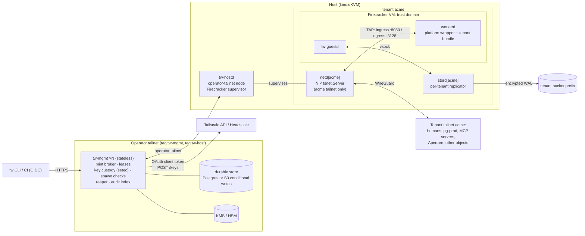
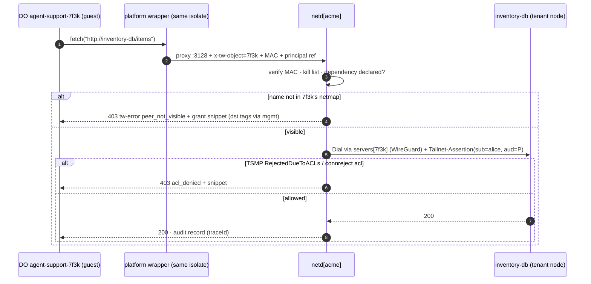
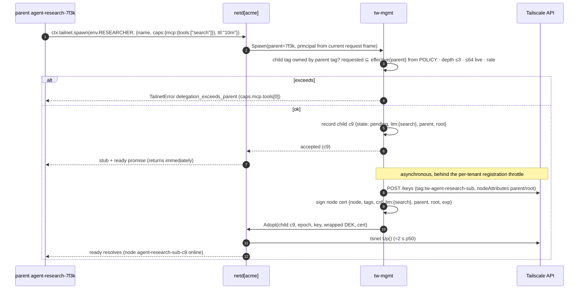

# RFC: tailworks, a tailnet-native Workers and Durable Objects runtime

Status: Draft, for public comment · Applies to: tailworks MVP and v1 · License of this document: CC-BY-4.0

What is built, and where it differs from this design: [As built (v0.2.0)](#as-built-v020).

---

## As built (v0.2.0)

> This RFC is the design tailworks started from, and it reads as that
> design. What shipped in v0.2.0, and on master since, differs in places.
> This table is the summary; sections the build revised carry a "Revised"
> note, and the rest of the text is not updated line by line. The operator
> docs describe the real behaviour: [README](../../README.md),
> [COMPAT.md](../COMPAT.md), [INSTALL.md](../INSTALL.md) and
> [concepts.md](../concepts.md). Each [ADR](adr/README.md) says whether
> it is built.

Status: **Built** as designed · **Differs**: built, but not as this RFC says · **Not built** · **Revised**: this RFC's text is revised in place.

| RFC | Claim | Status | As built |
|---|---|---|---|
| §1, §4.3 | Every workload and every object is its own tailnet node | Built | Objects of a class with tags in `tailnet.objects` get their own node ([concepts.md](../concepts.md)) |
| §1, §4.8 | Tenant code runs in Firecracker microVMs | Differs | The default is the process tier: workerd as a sandboxed process (Landlock and seccomp on Linux, Seatbelt on macOS; ADR-023). The microVM tier (Firecracker on Linux, Virtualization.framework on macOS; ADR-024, ADR-030) is opt-in, one VM per workload |
| §4.8 | One VM per trust domain (`isolation: "tenant"`, `"principal"`, `"object"`) | Not built | The unit of isolation is the workload |
| §4.8 | Per-object egress through a platform wrapper with a request MAC | Differs | Facet mode (the default) sends each object's `fetch()` from its own node; plain-DO mode sends it from the workload's node ([egress-modes.md](../egress-modes.md)) |
| §4.8 | Internet egress opt-in per class (`egress.internet`) | Revised | Internet egress is on by default per workload and leaves from the host's network through netd's SSRF guard, not via an exit node or gateway. `tailnet.egress.internet` (`false`, or an allowlist) turns it off or limits it, for Workers and containers alike (ADR-049, ADR-032); see §4.8 |
| §4.1, §4.2 | `netd[tenant]`: one process per (tenant, host), supervised by `tw-hostd` | Differs | netd is a Go library inside `tw-hostd`: one registry per tenant in the `tw-hostd` process, no separate daemon. `cmd/tw-netd` is a test harness for `make e2e-local` and is not shipped |
| §4.2, §4.8, §15 | `stord` (`tw-stord`): DO storage over vsock, encrypted per object, shipped to a tenant bucket | Not built | DO storage is a host-local directory (on the microVM tier, a per-workload volume). KV, D1 and R2 indexes are journaled in mgmt (ADR-044); Queues live in mgmt (ADR-039) |
| §4.9, §9, §10 | Async encrypted DO backup, RPO ≤ 5 s, a per-namespace restore drilled in CI | Not built | [ADR-012](adr/012-mvp-single-host-per-tenant-namespace.md) is amended. Back up the state directory ([INSTALL.md](../INSTALL.md#back-up-and-restore)). Moving a workload with Durable Objects to another host starts them empty (`tw host drain --allow-local-state-loss`); see [#38](https://github.com/rosskukulinski/tailworks/issues/38) |
| §4.9 | Namespace lease on S3 or Postgres, TTL 15 s, renew 5 s | Differs | The database is the lease clock (ADR-028): SQLite or Postgres, no S3. The namespace lease TTL is 45 s, and hosts fence themselves after 30 s without a renewal |
| §4.9, §9 | Parking, `gcAfter`, 500 online nodes per netd | Not built | Nodes stay online until their object is killed, reaped or undeployed. Hosts advertise a node capacity to placement (`tw-hostd -capacity-nodes`; by default a quarter of RAM at 8 MiB per node, 50 to 1000, from measurements: [limits.md](../limits.md#per-node-memory-measured)). Pool nodes (ADR-031) and warm keys make new objects faster. Whether parking and `gcAfter` are built or dropped is an open decision ([§4.9](#49-do-lifecycle)) |
| §4.9 | macOS pre-sleep hook | Not built | A sleeping Mac takes its nodes offline |
| §4.4 | Minting with a tenant OAuth client; single-use keys; warm keys; registration throttle | Built | ADR-042. The WIF and API-key modes were built, then removed. Headscale mints with a Headscale API key (ADR-015) |
| §4.3, §4.4 | Mint-time node attributes (`custom:tw-*`) | Not built | Auth keys carry tags only; lineage lives in tailworks' audit |
| §4.3, §8 | Node keys rotated on migration and every 30 days | Not built | A node keeps its key for its lifetime |
| §4.4, §4.8 | Node keys and DEKs in setec; the OBO root key in KMS | Differs | Node state lives in the host's state directory. mgmt's custody is a file store (AES-GCM, the default) or setec (`tw-mgmt -custody setec`); there is no KMS and no per-object DEK ([ADR-018](adr/018-use-setec-node-key-dek-custody.md) stays Proposed) |
| §4.4 | Browser OIDC login; CI deploys by OIDC token exchange | Not built | Developers, agents and CI runners on the tailnet use `tw link`: mgmt identifies the machine by WhoIs |
| §4.5 | `getCaller()`: WhoIs at ingress, `request.cf`, client identity headers stripped | Built | [COMPAT.md](../COMPAT.md#identity) |
| §4.6 | Node certificates with `lim`; spawn budgets (64 live, depth 3); `--cascade` | Built | ADR-025 |
| §4.6, §6 | Per-request on-behalf-of assertions (`Tailnet-Assertion`, `actingFor`); `forward()` re-signs the act chain | Not built | A receiver sees the calling node, not the human it acts for. The SDK has no `actingFor`, `chain` or `forward()`: to call on, re-send the request from the calling node with `ctx.tailnet.fetch(new Request(url, request))` ([COMPAT.md](../COMPAT.md#identity)) |
| §4.8, §6.1 | Stock `connect()` and `ctx.tailnet.connect()` | Built, differs | Raw TCP egress through the platform's egress entrypoints and netd's `DialEgress` (ADR-052). `ctx.tailnet.connect()` throws `not_supported` in plain-DO mode (no per-object identity before WD-3); stock `secureTransport` TLS doesn't work through workerd's `connect()` handlers, so TLS is `tls: "netd"` (hostd originates it) or off on the tailnet |
| §6.2, §6.3 | Go and Python verifiers | Not built | The packages are `@tailworks/tailnet`, `@tailworks/mcp`, `@tailworks/node` and `create-tailworks` |
| §4.11, §5.5 | Kill tiers 1 and 2 | Built | Tier 1 resets flows and closes the node; tier 2 deletes the device after a tombstone window |
| §4.11, §5.5 | Kill tier 3 (posture flip on `custom:tw-live`) | Not built | `tw kill` reports it as unavailable |
| §4.10 | Hash-chained, host-signed audit; `tw audit`; trace IDs | Built | Request logs, metrics and traces are ADR-045 (`tw logs`, `tw telemetry`) |
| §4.10 | A live log tail | Built | `tw logs -f` (ADR-045) |
| §3, §5.1, §7.2 | One command that connects a tailnet | Differs | `tw up --oauth-client-file` serves the first tailnet, `tw tenant add` the next ones; `tw up --control=headscale` for Headscale |
| §4.5, §4.6, §7, §9, §12 | `tw policy lint`, `tw policy test`, `tw policy push`, `policy.tw-tests.hujson` | Not built | `tw policy [dir]` prints the policy snippet an app needs, checked against the live policy; `tw deploy` runs the same preflight |
| §4.7 | A Tailscale Service per workload | Built | Opt-in per workload ([services.md](../services.md)) |
| §3 | Non-goals: KV, R2, D1 and Queues out of scope; not a VM platform | Revised | KV, R2, D1, Queues, Workflows (ADR-036 to ADR-040) and containers (ADR-032) ship; see §3 |
| §3 | Goal 1: the compatibility matrix in DX.md | Differs | [docs/COMPAT.md](../COMPAT.md), with the tests behind each row |
| §3 | Goal 6: ≤5 lines of code and one CLI step | Revised | See §3 |
| §10 | `tw-mgmt init`; N≥2 stateless replicas | Differs | `tw up` runs mgmt and a host in one process (SQLite, file custody). Replicas run `tw-mgmt` on Postgres behind `svc:tw-mgmt` ([services.md](../services.md#mgmt-replicas-svctw-mgmt)). Hosts join with `tw host add` |
| §10 | Blue/green deploys; `tw host drain`; N−1 upgrades | Built | ADR-041 |
| §4.9, §12 | v1: workerd cluster mode through upstream hooks (WD-1 to WD-4) | Not built | Single host per namespace (ADR-012) |
| §15 | `MAINTAINERS`, DCO sign-off, `rfcs/` | Not built | See §15 |

---

## 1. Summary

tailworks is a self-hosted, open-source runtime for Workers-style code and Durable-Objects-style stateful objects. It is built on workerd. **Every workload and every object instance is its own node in its owner's tailnet**, with its own MagicDNS name, tags, grants and flow-log entries. Tenant code runs in Firecracker microVMs. Each VM's network is a host-side, tsnet-backed "Tailscale NIC" (the tailvisor pattern), so node keys never enter the guest.

Agents are the flagship use case:
- An agent is an object, so it is a tailnet node.
- A sub-agent is another object with a narrower tag.
- A tool call is authorized by grants and app capabilities, which the platform reads from WhoIs.
- "On behalf of alice" is a short-lived, per-request assertion bound to the sending node's key.

The network enforces who may talk to whom. Tailworks enforces the finer-grained values that the network can't express yet.

The design is a hybrid:
- **Control and security model.** A management plane (`tw-mgmt`) mints every node, holds its key, and releases the key only to the host holding that object's lease. Hosts never hold a credential that can mint nodes.
- **Upstream alignment.** Durable Objects are stock workerd DOs. The MVP is single-host per tenant namespace. v1 adopts workerd's upstream cluster mode through public hooks that we contribute.
- **No new protocol is required.** Every proposed Tailscale-side change has a working fallback, including on Headscale.

## 2. Motivation

AI agents are short-lived and numerous. They act on behalf of humans, spawn sub-agents, call tools (MCP), and need to reach private infrastructure. Today they reach that infrastructure in one of three ways:
- public exposure (tunnels or Funnel-style ingress) plus long-lived API keys;
- a VPN appliance shared by every agent;
- a cloud-specific private-networking product that identifies a *binding*, not an agent.

None of these gives each agent instance an identity that the network itself checks, that a tool server can read in one line, or that revocation can target.

Tailscale already has the primitives needed:
- node identity, tags, and grants with app capabilities;
- WhoIs with CapMap;
- MagicDNS, Services and ephemeral nodes;
- OAuth clients scoped to auth keys for one tag, so a platform can mint node keys without an all-powerful API key.

The missing piece is a *compute runtime* that makes these primitives the default for each object.

**Why not an SDK in every runtime?** We tried that framing first; see §11. Embedding a full userspace node inside a serverless isolate hits a hard memory ceiling. The Go wasm client is 27–37 MB and uses 120–145 MB RSS, against a 128 MB isolate cap. There is no UDP, so all traffic is DERP-relayed, and keep-alives defeat hibernation. If the host runtime is itself a native tailnet node, all of those problems disappear.

**Positioning.**

| Alternative | How tailworks differs |
|---|---|
| Cloudflare Workers VPC / Mesh | Hosted only, with identity per binding. Tailworks gives *per-object* identity in the *customer's* tailnet, and is self-hostable |
| Rivet | Self-hostable actors, but no Workers API and no network identity |
| Fly.io | Firecracker plus per-org WireGuard, but identity is per app and there is no DO primitive |

The defensible claim is narrow: tailworks is the Workers/DO runtime where each object is a first-class principal in *your* network.

## 3. Goals and non-goals

**Goals**
1. Existing Workers/DO code runs under a **documented compatibility matrix** ([docs/COMPAT.md](../COMPAT.md)). That covers fetch, DO storage (KV and SQL), alarms, WebSocket hibernation, DO JS RPC, and the Agents SDK `Agent` and `McpAgent`.
2. **Node per object** (and per workload), in the owner's tailnet. Hosts serve tenants from different tailnets at once.
3. **No long-lived customer secret** in tailworks storage on Tailscale SaaS. No secrets of any kind inside the guest.
4. **Tool-level authorization** from grants and app caps, read in one line: `getCaller(request)`.
5. **Per-request on-behalf-of**, sub-agent narrowing without an admin round-trip, a three-tier kill switch, and a tamper-evident audit chain.
6. **Quickstart:** ≤5 lines of code plus one CLI step to the first private fetch, after a one-time tailnet setup.
7. **Self-hosted first**, with Tailscale SaaS and a Headscale profile. A hosted offering is not precluded.

> Revised (as built, v0.2.0). Goal 5: sub-agent narrowing, tamper-evident
> audit and kill tiers 1 and 2 are built; per-request on-behalf-of and kill
> tier 3 are not. Goal 6: app code stays a few lines, but the one-time
> setup is longer than one step: `tw up` with an OAuth client, plus policy
> edits in the admin console (the [README](../../README.md) quick start).
> The planned one-step setup command was not built.

**Non-goals**
- **Not an agent framework.** We ship adapters for the Cloudflare Agents SDK and the MCP TypeScript SDK. Other frameworks (Claude Agent SDK, LangGraph, OpenAI Agents SDK) are *clients* that reach tailworks tools over the tailnet.
- **Not an LLM gateway.** LLM traffic goes to Aperture (or any gateway) as an ordinary tailnet destination, and the gateway identifies each agent object by its node.
- **Not a secrets manager.** tailworks removes the *network* secret. Application credentials remain the application's concern.
- **Not a general-purpose VM platform.** The guest image is fixed: kernel, `tw-guestd` and workerd.
- **Not a Cloudflare replacement.** KV, R2, D1, Queues and Workers AI are out of scope for the MVP.

> Revised (as built, v0.2.0). Two non-goals moved. Containers
> ([ADR-032](adr/032-containers-code-sandboxes.md)) run tenant OCI images,
> one microVM per container, attached to a Durable Object; the Worker's own
> guest image is still fixed. KV, R2, D1, Queues and Workflows ship as
> platform stores and bindings (ADR-036 to ADR-040, ADR-044). Workers AI is
> still out of scope: use an LLM gateway on your tailnet.

## 4. Design

### 4.1 Architecture



### 4.2 Components

| Component | Runs where | Responsibilities | Never holds |
|---|---|---|---|
| `tw` CLI | Developer laptop, CI | As built: `up`, `init`, `dev`, `link`, `deploy`, `policy`, `types`, `kill`, `audit`, `logs` and more (`tw help`); the design's `connect`, `policy test/lint/push` and `tail` were not built | Any tailnet key |
| `tw-mgmt` | Operator tailnet, N≥2 stateless replicas | Tenant registry; minting broker; namespace and object leases; per-object key custody; spawn verification against policy; reaper/reconciler; audit index | Decrypted node keys (it unwraps a DEK only *for* a lease holder) |
| `tw-hostd` | One per host | The host's operator-tailnet node (`tag:tw-host`); Firecracker and netd supervisor; lease renewal; sleep hooks on dev hosts | Tenant node keys |
| `netd[tenant]` | One process per (tenant, host) | N `tsnet.Server`s in the tenant's tailnet; ingress demux with WhoIs; attributed egress proxy; assertion signing and verification; local policy check for object→object calls; Tier-1 kill; audit records | Mint credentials; other tenants' keys |
| `stord[tenant]` (not built; see As built) | One process per (tenant, host) | Receives DO storage I/O from the guest over vsock; local fsync; encrypts with the per-object DEK; ships asynchronously to the tenant bucket prefix | Other tenants' data |
| Guest image | Firecracker VM | A minimal kernel, `tw-guestd` (init, vsock storage, health) and pinned upstream workerd | Node keys, bucket credentials, signing keys |
| workerd | In the guest | Stock upstream binary. Runs a generated platform wrapper plus the tenant bundle with real DO namespaces | Nothing secret |

- netd depends on tailvisor's `netd` as a Go library: ARP/DHCP/DNS/ICMP, the gVisor stack, and `UseNetstackForIP` pinning. The multi-node registry lives in our repo.
- The host's tailnet layer sits behind an internal interface. Go tsnet is the reference implementation, and tailscale-rs is tracked as a future core.

### 4.3 Identity model

| Principal | Tailnet representation | MagicDNS name | Tags |
|---|---|---|---|
| Tenant | A trust domain in one tailnet, bound by its own OAuth client (§4.4). A tailnet may hold several, one per team, each with its own owner tag and name prefix ([ADR-043](adr/043-team-tenants.md)) | — (with a name prefix, every generated name is `<prefix>-<name>`) | Its owner tag (`tag:tw` by default) owns its tags through `tagOwners` |
| Workload (a Worker) | One node per (workload, host), advertising `svc:<workload>` where Services exist | `<workload>-<host>`; Service `<workload>` | `tailnet.tags`, by default `tag:tw-wl-<workload>` (2026-11-24, #491: also when `tailworks.jsonc` leaves `tailnet.tags` out) |
| Object (a DO instance) | **One persistent node per object** | `<class>-<b32(hmac(id))[:10]>` by default; `<class>-<slug>` if the class sets `publicNames` | From class config, e.g. `tag:tw-do-room` |
| Agent | An object of an Agents SDK class | as for objects | e.g. `tag:tw-agent-support` |
| Sub-agent | An object spawned by an agent, with its own persistent node, reaped at TTL | as for objects | A child tag whose grants are ⊆ the parent's |
| Human | Their own devices. Tailworks never impersonates them | — | — |
| Operator plane | Nodes in the operator tailnet only | `tw-mgmt-*`, `tw-host-*` | `tag:tw-mgmt`, `tag:tw-host` |

Rules:
- **Authorize on node identity and tags, never on hostnames.** MagicDNS de-duplicates names with suffixes, and a hostname can be squatted. `getCaller()` exposes `nodeId` (the stable node ID) and `tags` as primary keys, and exposes `hostname` for display only.
- **Objects use persistent nodes,** because a stable 100.x address and name are the point. Ephemeral nodes get a new IP each time, and a crashed one lingers for 30–60 min [verified: tailscale.com/kb/1111]. Sub-agents are persistent too, and the tailworks reaper deletes them. That avoids consuming ephemeral-minute quotas.
- **Mint-time attributes.** At mint, the mint broker sets `custom:tw-live=true`, `custom:tw-obj=<id10>`, `custom:tw-parent=<id10>` and `custom:tw-root=<id10>` through the key's `nodeAttributes`. Custom attributes need a plan that supports them [verified: tailscale.com/kb/1288]. Without them, lineage lives only in tailworks' audit.
- **Node key rotation.** Tagged nodes have key expiry disabled by default. Tailworks rotates node keys on every migration and every 30 days [assumption: rotation via re-auth with a fresh single-use key, preserving the device].

**On-behalf-of is per request, not per object.** An object that serves alice and then bob attributes each call to the human in *that* request's verified chain. Docs recommend keying agent objects per human (`getByName(login)`), but correctness does not depend on it.

### 4.4 Credential bootstrap

> Revised by ADR-042. The first design used workload
> identity federation (mgmt as an OIDC issuer, trust credentials per
> tenant) with an API key as a fallback; both modes were built (M10, M2)
> and then removed. A self-hosted operator owns the tailnet and the host,
> so an OAuth client gives the same scoping without a public issuer, a
> Funnel node or HTTPS. A mgmt that holds other operators' credentials
> would revisit a secretless option.

**Tailscale.** The tenant admin creates one OAuth client in the admin console:

```jsonc
// required: it can only create auth keys for tags tag:tw owns.
{ "scopes": ["auth_keys"], "tags": ["tag:tw"] }
// optional scopes: devices:core (kill Tier 2 and the reaper delete devices),
// policy_file:read (deploy preflight, spawn checks), services (Tailscale Services).
```

- The secret stays in a 0600 file on the mgmt host. Tailworks stores the file's path and the client's public ID, re-reads the secret at each client-credentials exchange (`POST /api/v2/oauth/token`), caches the access token until shortly before it expires, and never logs or copies the secret.
- `tag:tw` must own tailworks' own tags (`tag:tw-mgmt`, `tag:tw-host`) and the workload tags, so the client can mint their keys; `tw up` checks this before minting anything.
- **Auth keys are single-use, preauthorized, and expire in ≤5 min.** Revoking the client therefore leaves no usable key behind.
- **The customer's kill switch** is to revoke the OAuth client.
- **Caveat.** `devices:core` is tailnet-wide. Restricting it to `tag:tw-*` devices is an open question (TS-5). Until it is answered the scope is opt-in, and the reconciler only ever acts on devices that tailworks itself minted.

**Minting** is done by tw-mgmt and never by a host:
1. Get an access token for the tenant's OAuth client (cached).
2. Call `POST /api/v2/tailnet/-/keys` with `{reusable:false, preauthorized:true, tags:[…], nodeAttributes:{…}, expirySeconds:300}`.
3. Send the key over the operator tailnet to the one host holding the lease. That host uses it once.

We call the REST API ourselves because tsnet can't set `nodeAttributes` on a join. The mint broker keeps **5 warm keys** per (tenant, tag set), not warm nodes, refreshed before they expire. A cold join still takes ~2 s (§9), so warm keys only remove the mint round-trip. All minting goes through the per-tenant registration throttle (§4.9), and object creation is asynchronous.

**Other control planes**

| Control plane | Credential | Long-lived secret? |
|---|---|---|
| Tailscale | An OAuth client scoped to `auth_keys` and `tag:tw` | Yes: the client secret, in a 0600 file on the mgmt host |
| Headscale profile | A Headscale API key that mints tagged, single-use pre-auth keys (ADR-015) | Yes. Headscale has no OAuth clients |
| `tw dev` | None. An embedded control plane | No |

**Developers and CI** (no secret anywhere):
- `tw link`: self-hosted tw-mgmt identifies the developer by WhoIs over the tailnet. (Hosted tw-mgmt's browser OIDC login is not built.)
- CI deploys exchange GitHub/GitLab OIDC tokens with tw-mgmt (trust rules per repo and environment). (Not built.)
- Hosts enrol in the operator tailnet with a single-use key minted by tw-mgmt, then persist their node key.
- `tw link` binds a checkout to a tenant and namespace in `.tailworks/`, which is gitignored.

### 4.5 Authorization

**Grants are the source of truth.** For every inbound connection, netd calls `WhoIs` (or `WhoIsForService` on a Service listener). That is a local netmap lookup with no control round-trip. netd verifies any `Tailnet-Assertion`, then sets the `x-tw-cf` blob, which workerd's `cfBlobHeader` strips and parses into `request.cf`. Tenant code never reads `request.cf.tailscale` directly. The portable API is:

```ts
import { getCaller } from "@tailworks/tailnet";
const who = getCaller(request); // { nodeId, tags, user?, actingFor?, chain, caps(), traceId }
```

**Cap merge semantics** follow `wgengine/filter`: values from every matching grant are *appended*, i.e. unioned [verified: tailscale/wgengine/filter/filter.go:410-435]. For numeric limits the helper takes the **max** across entries. Adding a grant can therefore only widen a limit, and `tw policy lint` warns when two grants give the same (src, dst) different limits (not built).

**Values finer than a tag**, such as "this sub-agent: refund ≤ $10", go into the **object's node certificate**. tw-mgmt signs that certificate at spawn (§4.6) and attaches it to every assertion. Receivers compute:

```
effective = union(CapMap values for this src→dst)  ∩  cert.lim   // lim only narrows
```

This holds until Tailscale can carry per-node cap values (TS-2).

**Object→object calls inside a tenant.** DO bindings and JS RPC stay in-process; they don't take a network hop. But the platform wrapper asks netd's local policy evaluator (an internal call of about 0.1 ms) whenever caller and callee tags differ. A narrowed sub-agent therefore can't use its parent's broader authority through a binding. `tw init` writes the Worker→DO grant for generated code.

**MCP.** Inside the tailnet, WireGuard plus WhoIs is the authentication. There's no OAuth dance, which matches MCP's model of environment-provided credentials for local transports. `@tailworks/mcp` checks `who.caps("<domain>/cap/mcp")` per tool. Stateful limits such as a daily budget use a **budget DO** per (root principal, tool), which serialises spend. Out-of-tailnet MCP clients are out of MVP scope; the v1 path is RFC 9728 metadata pointing at tsidp.

### 4.6 On-behalf-of assertions and delegation

The resolutions drop bearer delegation tokens. On-behalf-of is a **per-request assertion signed by the sending netd and bound to the sending node**.

- **Per-object assertion key.** At mint, tw-mgmt generates an Ed25519 key for each object and stores it with the node state, under the same DEK.
- **Node certificate.** tw-mgmt signs a node certificate `{tenant, node: StableNodeID, tags, cnf: <assertion pubkey>, lim?, parent?, root?, exp: 24h}` with the tenant's **OBO root key**. That key is in KMS. Its public key is published with the tenant (`GET /v1/tenants/{id}`, `oboPublicKey`), and hosts pin it.
- **Per request.** On each egress that carries a principal, netd signs a compact JWS:

```json
{ "typ": "tw-obo+jwt",
  "iss": "tw:tn_8c2f", "sender": "nCNTRL7f3k", "aud": "nCNTRLk9x2",
  "sub": "p_Qm4…",                 // HMAC(tenant, human, dstNode): pairwise per destination
  "grp": ["group:sre"],            // only groups named by the destination's caps
  "act": { "sub": "nCNTRL7f3k", "act": { "sub": "nCNTRLa001" } },
  "cert": "<node certificate>", "txn": "4bf92f3577b34da6a3ce929d0e0e4736",
  "iat": 1762531200, "exp": 1762531260, "jti": "b1c…" }
```

The receiver (netd, or `@tailworks/verify` in Go/TS/Python) accepts the assertion only if all of these hold:
1. The cert chains to the tenant OBO root.
2. `cert.node == WhoIs(transport peer).Node.StableID`.
3. The signature verifies against `cert.cnf`.
4. `aud` is the receiving node.
5. `exp − iat ≤ 60 s`.
6. The `jti` has not been seen before (replay cache).

A recipient therefore can't re-bind or replay an assertion. Multi-hop calls use the `act` chain, and every hop re-signs. A tool server that calls downstream on the caller's behalf uses `ctx.tailnet.forward(request, url)`, which appends itself to `act`.

The real login is resolvable only through the tenant's audit log. A destination whose caps declare `"identity": "login"` receives `login` in place of the pairwise `sub`.

**Sub-agent narrowing:**
- **Network bound.** The child tag's grants. `tw policy test` (not built) statically checks that every grant whose src is a child tag is ⊆ the parent tag's grants, including cap values.
- **Per-spawn bound.** At spawn, tw-mgmt computes the parent's effective caps from *policy* (the embedded evaluator), not from observed traffic, so the first spawn works. It checks `requested ⊆ effective(parent)`, writes `lim` into the child's certificate, and records the lineage.
- **Budgets.** Each root principal may have at most 64 live descendants, a depth of at most 3, and a limited spawn rate.
- **Reaping.** A parent dead past its TTL causes its children to be deleted.

### 4.7 Discovery and naming

| Target | Address | Notes |
|---|---|---|
| Object, by default | `http://room-q3k9x2m1ab.<tailnet>.ts.net/` | MagicDNS goes straight to the owner host's netd. Plain HTTP: WireGuard already authenticates and encrypts. Per-object certificates are deferred to v1 because of ACME issuance limits |
| Object, `publicNames: true` | `http://room-lobby.<tailnet>.ts.net/` | Opt-in, because names show in the admin console |
| Workload or MCP server | `https://<workload>.<tailnet>.ts.net/` = `svc:<workload>` | A Tailscale Service, with HTTPS from the Service. On Headscale: a single workload node, MagicDNS only |
| Object by name via its workload | `https://chat.<tailnet>.ts.net/_tw/o/Room/lobby/…` | Wakes parked objects. netd passes the original caller through as a signed assertion, never the workload's identity |
| From Worker code | `env.ROOM.getByName("lobby")` | Stock workerd binding (§4.5) |

**Declared dependencies.** `tailworks.jsonc` lists `tailnet.connects: ["tag:db", "svc:inventory"]`. `tw deploy` pre-checks each entry against policy; `tw dev` mocks them.

Tenant egress never falls back to the host resolver; object nodes resolve through netstack only. A name under the tailnet suffix, or a bare short name, that isn't in the netmap yields `peer_not_visible`. That error names the dependency and the missing grant: tw-mgmt looks up the destination's tags, and the error includes a HuJSON snippet.

### 4.8 Data plane

**Ingress.**
1. netd runs `Listen("tcp", ":80")` per object node, and `ListenService` per workload.
2. On accept it calls `WhoIs`, verifies the assertion, applies the kill list, and strips every client-supplied `x-tw-*` and `Tailnet-Assertion` header.
3. It sets `x-tw-cf` and forwards to the guest's **ingress socket** at `192.168.72.2:8080`. Only that socket has `cfBlobHeader`.
4. The platform wrapper routes on `objectId` to `env[ns].get(id)`.
5. Raw TCP uses a PROXY-v2 preamble with an `objectId` TLV.

**Egress.** Every Worker's `globalOutbound` is the platform `Egress` service, which reaches netd's attributed proxy at `192.168.72.1:3128`. There is a **separate socket** for each direction.

The egress proxy:
- refuses loopback, link-local, the host's own tailnet IPs and platform endpoints;
- never dials the guest ingress. A same-host object destination is delivered through netd's internal hop, which sets the cf blob from the *attributed source*;
- strips identity headers and originates TLS for `https://` URLs;
- **denies the public internet by default.** A class opts in with `egress.internet: ["api.openai.com"]`, routed through an exit node or a gateway such as Aperture.

> Revised (ADR-049). Internet egress is **on** by default, per workload, as on Cloudflare. It leaves from the host's own network, never from a tailnet node, after an SSRF guard that refuses loopback, private, link-local (metadata), CGNAT/tailnet and host addresses on the address actually dialled. `tailnet.egress.internet: false` turns it off, and a list limits it, for Workers and containers alike. A gateway on the tailnet remains the way to get a fixed source address.

**Per-object egress attribution** must be set by the platform, and tenant code must not be able to change it. Stock workerd sets `globalOutbound` per Worker, not per DO instance. The MVP uses a generated platform wrapper:
- The wrapper subclasses each DO class and runs every entrypoint (fetch, alarm, webSocket\*, RPC) inside a platform-held context frame `{objectId, principal}`.
- It replaces global `fetch` before tenant modules evaluate. It stamps `x-tw-object` and a per-request MAC bound to (objectId, method, URL, nonce), under a VM key held in a module-private closure.
- netd rejects unattributed requests, or treats them as the workload node.
- Stock `connect()` egresses as the **workload** node. `ctx.tailnet.connect()` egresses as the object.

Upstream ask WD-3, a per-actor `globalOutbound`, retires the wrapper. [assumption: to be confirmed by the per-object identity prototype]

**Residual risk.** Tenant code with a V8 escape inside a VM can impersonate the other objects *in that VM*. The mitigation is placement: **one VM per trust domain**.
- Plain DO classes default to `isolation: "tenant"`.
- Agent classes default to `isolation: "principal"`, one VM per (tenant × human).
- Any class may choose `isolation: "object"`.

Firecracker VMM overhead is ≤5 MiB per VM; guest memory dominates.

**Operator fabric.** It lives in `tw-hostd`, a separate process outside every tenant netd. Operator peers are authenticated by WhoIs node ID and tags, never by hostname. Tenant traffic never crosses the operator tailnet.

**Storage.** The guest mounts `/tw/objects` through `tw-guestd`, which ships SQLite I/O over vsock to that tenant's `stord`.
- stord fsyncs locally.
- It encrypts WAL frames with the **per-object DEK**. DEKs and node state are held in **setec** (tailscale/setec, BSD-3): access is granted by policy via `tailscale.com/cap/secrets` to `tag:tw-mgmt` only, and bootstrap uses KMS, a TPM-sealed key or homelab mode. tw-mgmt releases them only to the lease holder. This is the same broker pattern as tailscale/thundersnap's coordinator.
- It ships them asynchronously to a **per-tenant** bucket prefix, using a host-held per-tenant credential.

No bucket credential enters the guest, and no storage service is shared across tenants.

### 4.9 DO lifecycle

**States.** `live-hot ⇄ live-hibernated ⇄ parked → deleted`.

| State | Isolate / VM | Node | Directly reachable? | Device exists? |
|---|---|---|---|---|
| live-hot | running | online | yes | yes |
| live-hibernated | evicted after 10 s idle; VM may pause | **online** (~2.5 MB) | yes: SYN → netd resumes the VM → forward | yes |
| parked | none | closed, not logged out; device kept | no; reachable through `/_tw/o/…` on the workload, which wakes it (TS-3 would add direct wake) | **yes** |
| deleted | — | `DELETE /device` | no | no |

- **Parking.** Objects are parked LRU-first when the host exceeds its node budget (§9).
- **GC.** Parked objects are deleted after `gcAfter`, a first-class setting that bounds the device count.

> As built (v0.2.0), and **open: a decision for Ross.** Neither parking
> nor `gcAfter` is built. A node stays online until its object is killed,
> reaped or undeployed, and placement stops sending a host objects at its
> node capacity, which is now derived from RAM with measured per-node
> costs: about 2.5 MB idle and 4 MB under load per node with scoped peers
> ([limits.md](../limits.md#per-node-memory-measured)). At that cost a
> 16 GiB host's default 512 nodes use about 2 GB, so memory alone doesn't
> force parking yet. The options:
>
> 1. **Drop both.** Keep nodes online; bound a host by its capacity and a
>    tenant by its quota; spread across hosts. Simplest, and what runs
>    today. An object that is never used again keeps its node and device
>    until it is deleted, so device count tracks object count.
> 2. **Parking only.** Close the least recently used idle nodes when a
>    host is over its budget, keeping their state so the next request
>    through the workload rejoins them from saved state (no new
>    registration, same address). Frees RAM; devices stay (offline). Costs
>    a wake path through the workload and a first request that waits for
>    the rejoin.
> 3. **Parking and `gcAfter`.** Option 2, plus deleting the devices of
>    objects parked longer than `gcAfter`. Bounds the device count. A
>    woken object then registers again and gets a new node: a new address
>    and a new device in flow logs.
> 4. **Defer.** Keep option 1 and revisit when a host reaches its node
>    capacity in practice, or when device count becomes the constraint.

**Creation is asynchronous.** `create()` (an implicit first `getByName`, or `ctx.tailnet.spawn`) records the object and returns immediately. The node becomes ready later.
- Until the node is ready, inbound requests through the workload queue at netd, and the object's own egress waits on `ready`. After `readyTimeout` (default 30 s), both fail with `identity_pending`. Egress never falls back to another identity.
- tw-mgmt mints and registers through a **per-tenant registration throttle**, `registrationsPerMinute`, which is configurable and defaults to 200. On 429s or 5xx it backs off adaptively (AIMD with jitter), so it **respects the coordination server's registration rate limits**. Queue depth is exported as `tw_registration_queue` and pages when it keeps growing.
- Restarts, upgrades, drains and failovers **rejoin from saved node state** and never re-register. They consume no auth key and no registration budget.

**MVP: single host per tenant namespace.**
- **Lease.** A namespace lease `lease/<tenant>/<ns> = {host, epoch, expiresAt}` is a conditional write on the durable store (S3 `If-Match`/`If-None-Match`, or Postgres). TTL is 15 s with a 5 s renew.
- **Key release.** The lease is also the right to run the namespace's object nodes: tw-mgmt unwraps DEKs only for the current `(host, epoch)`.
- **Self-fencing.** netd self-fences at `TTL − margin`, not on a liveness probe, and deploys don't trigger it.
- **Failover.** If the host is lost, another host acquires the next epoch after expiry. It restores from the encrypted backup and rejoins nodes from their saved state, so the node keys and 100.x addresses are unchanged.
- **Durability.** The default is `local` (local fsync plus asynchronous backup).
- **Laptops** are dev or static-owner hosts only. On macOS, netd closes object nodes from a pre-sleep hook (`kIOMessageSystemWillSleep`) and re-validates the lease before reopening them.

**v1: workerd upstream cluster mode** via public hooks (§12), with no reads of workerd's private bucket layout. v1 needs four upstream hooks:
- an ownership-change event stream with an epoch, so the node follows the owner and tw-mgmt releases DEKs on the observed epoch;
- degrade-to-read-only instead of exit on a bucket stall;
- a re-homing hook for objects reached by direct name after host loss;
- cluster key rotation.

`durability: "sync"` is opt-in and requires ≥3 hosts. A single-node MinIO is not supported for multi-host.

**Placement freezes** whenever Tailscale control is unreachable (tsnet health plus a synthetic map-poll probe), or the durable store is down. In either case there are no voluntary moves, existing nodes keep working on cached netmaps, and current lease holders keep their epoch.

### 4.10 Observability and audit

- **Attribution chain.** Lineage lives in tw-mgmt (`human → agent → sub-agent`). Each request carries a signed `act` chain. Each object has its own node ID in Tailscale flow logs, where the plan includes flow logs. Joining the node ID to the object record to the lineage is `tw audit`.
- **Trace ID.** netd generates the W3C trace ID; the guest can't set it. A guest-supplied ID is kept only as `parentHint`. The ID goes into the assertion's `txn`, so it survives hops through platform and non-platform servers.
- **Audit log.** netd writes L7 records `{ts, tenant, srcNode, dstNode, srcObject, dstObject, sub, chain, tool, verdict, grant, traceId}`. Records are **hash-chained per host and signed with the host key**, exported over OTLP, and indexed by tw-mgmt. Commands are `tw audit <object|human|trace>` and `tw logs -f`.
- **Independent cross-check.** The Tailscale configuration audit log records every mint and delete under the federated credentials.

### 4.11 Safety and kill switch

- **Default deny.** tailworks emits no grant to `*`. Example policies scope grants tag→tag.
- **Blast radius of a prompt-injected agent:**
  - it reaches only what its grants allow and cannot reach the public internet unless opted in;
  - it can't read its own key or mint nodes;
  - it can't widen a child, and is bounded by spawn budgets.
- **Kill switch:**

| Tier | Mechanism | Target latency | Needs |
|---|---|---|---|
| 1 | netd drops the object's flows in both directions, refuses its assertions, stops its isolate and closes its node. Host-local, so it works with tw-mgmt down (hosts hold a pre-delegated kill list) | < 1 s (prototype measures) | Nothing |
| 2 | tw-mgmt deletes the device. Peers drop it on the next netmap | seconds (to measure) | Lifecycle credential |
| 3 | Set `custom:tw-live=false`, so every grant with `srcPosture: posture:tw-live` stops matching. Applies per object or to a whole tag | netmap propagation (unpublished; to measure) | Lifecycle credential and custom-posture plan; not on Headscale |

- **Cascade.** `tw kill` cascades by default (`--cascade=false` opts out; the reaper then kills the orphans), following `lineage.root`.
- **Bypasses closed.** In-VM bindings are policy-checked (§4.5), and assertions expire within 60 s.

## 5. Sequence diagrams

### 5.1 Bootstrap: a tenant connects their tailnet

```mermaid
sequenceDiagram
  autonumber
  actor A as Tenant admin
  participant CLI as tw CLI
  participant M as tw-mgmt
  participant TS as Tailscale API
  participant H as hostd + netd[acme]
  A->>CLI: tw up --oauth-client-file … (or tw tenant add acme.com)
  M-->>CLI: policy snippet (tagOwners, postures, grants), OAuth client spec
  A->>TS: apply policy; generate the OAuth client (auth_keys, tag:tw)
  A->>CLI: save the client to a 0600 file on the mgmt host
  CLI->>M: RegisterTenant{mintMode: oauth, oauthClientFile}
  M->>TS: POST /oauth/token (client credentials)
  TS-->>M: short-lived API token
  M->>TS: POST /keys (single-use, preauthorized, tags, nodeAttributes, 300 s)
  TS-->>M: tskey-auth-…
  M->>H: Lease(acme/chat, epoch 1) + key + wrapped DEKs (operator tailnet)
  H->>TS: tsnet Up() for chat-h1 (≈2 s p50)
  CLI-->>A: connected · plan features: posture ✓ flow logs ✗ · svc:chat auto-approved
```

### 5.2 Private fetch from an object



### 5.3 Tool call with a capability check

```mermaid
sequenceDiagram
  autonumber
  participant A as netd (agent-support-7f3k)
  participant M as netd (svc:payments-mcp)
  participant S as MCP handler (payments)
  participant B as Budget DO (root=alice, tool=refund)
  A->>M: POST /mcp tools/call refund {usd: 40} + Tailnet-Assertion
  M->>M: WhoIsForService → tags, CapMap · verify cert.node == peer, aud, exp, jti
  M->>S: x-tw-cf {caller, actingFor, caps, lim}
  S->>S: caps("acme.com/cap/mcp"): refund, maxUsd = max(50) ∩ lim → 50 ≥ 40
  S->>B: reserve(40) (serialised; perDayUsd 200)
  alt over limit
    B-->>S: cap_limit_exceeded (remaining 10)
    S-->>A: JSON-RPC error TailnetError[cap_limit_exceeded]
  else ok
    B-->>S: ok (remaining 160)
    S-->>A: result · audit {trace, chain, tool, amount}
  end
```

### 5.4 Sub-agent delegation



### 5.5 Revocation and kill

```mermaid
sequenceDiagram
  autonumber
  actor S as Security on-call
  participant M as tw-mgmt
  participant N as netd(s) hosting root + descendants
  participant TS as Tailscale API / control
  participant X as every peer
  S->>M: tw kill agent-support-7f3k --cascade --reason "prompt injection"
  M->>M: resolve lineage.root → {7f3k, c9, d2}; record in store
  par Tier 1 (host-local)
    M->>N: Kill{nodes, until}
    N->>N: drop flows, refuse assertions, stop isolates, Close() (<1 s target)
  and Tier 3 (network)
    M->>TS: POST /device/{id}/attributes custom:tw-live=false (per node)
    TS->>X: netmap: posture:tw-live no longer matches → grants drop
  end
  opt Tier 2 (permanent)
    M->>TS: DELETE /device/{id}
  end
  M-->>S: audit: alice → 7f3k → [c9, d2] revoked; last allowed request trace …
```

### 5.6 Object wake (MVP), and migrate (v1)

```mermaid
sequenceDiagram
  autonumber
  participant C as Client (tenant tailnet)
  participant N as netd[acme]@H1 (node room-lobby online)
  participant V as tenant VM@H1 (paused)
  participant St as stord[acme]
  C->>N: SYN room-lobby:80 (direct or DERP)
  N->>N: lease(acme/chat) epoch 4 valid? (TTL − margin)
  N->>V: resume VM; forward with x-tw-cf
  V->>St: SQLite I/O over vsock → local fsync (durability local)
  V-->>C: 200
  Note over N,St: v1 only: migrate via upstream cluster hooks
  participant M as tw-mgmt
  participant N3 as netd[acme]@H3
  M->>N: drain(room-lobby)
  N->>V: release object (workerd cluster handoff)
  V-->>M: ownership event {room-lobby, owner=H3, epoch 9} (upstream hook)
  N->>N: Close() node (no logout)
  M->>N3: Adopt(room-lobby, epoch 9) + unwrap DEK
  N3->>N3: tsnet Start from saved state (same key, new endpoints, ≈4 s)
  C->>N3: same 100.x / MagicDNS name; new path via disco
```

## 6. API reference sketch

### 6.1 TypeScript (`@tailworks/tailnet`)

```ts
export interface Caller {
  nodeId: string;                       // stable node ID; primary key
  tags: string[];
  hostname: string;                     // display only; never authorize on it
  user?: { login: string };             // untagged human callers only
  actingFor?: { sub: string; login?: string; groups: string[]; verified: "tw-assertion" | "control" };
  chain: Array<{ nodeId: string; tags: string[] }>;   // nearest hop first
  caps<T = unknown>(name: string): T[];               // CapMap ∩ cert.lim, JSON-decoded
  traceId: string;
}
export function getCaller(req: Request): Caller;       // throws TailnetError("no_identity")
export function authorize(caller: Caller, cap: string,
  facts: Record<string, string | number>): void;       // throws acl_denied | cap_limit_exceeded

export interface SpawnOptions {
  name: string;
  caps?: Record<string, unknown>;     // must be ⊆ parent's effective caps
  ttl?: string;                       // single source of truth; class config sets the default
  principal?: "inherit" | "none";     // default: the current request's principal
}
export interface Spawned<T> {
  stub: DurableObjectStub<T>;             // usable at once; calls queue until the node is ready
  name: string;                           // MagicDNS name, final once ready
  state(): "pending" | "ready" | "failed";
  ready: Promise<void>;                   // rejects with TailnetError("identity_pending" | "bootstrap_failed")
}
export interface TailnetContext {
  fetch(input: RequestInfo | URL, init?: RequestInit): Promise<Response>;   // throws TailnetError
  connect(address: string | SocketAddress,
          opts?: SocketOptions & { tls?: "netd" | "starttls" | "off" }): Socket;
  forward(request: Request, to: string | URL, init?: RequestInit): Promise<Response>; // re-signs act chain
  spawn<T extends Rpc.DurableObjectBranded>(ns: DurableObjectNamespace<T>,
          opts: SpawnOptions): Promise<Spawned<T>>;   // resolves once the controller accepts; node not yet ready
  kill(opts?: { reason?: string; cascade?: boolean }): Promise<void>;      // self or own descendants only
}
declare module "cloudflare:workers" {
  interface DurableObjectState { readonly tailnet: TailnetContext }        // injected by the platform wrapper
  interface ExecutionContext   { readonly tailnet: TailnetContext }        // workload identity
}

export type TailnetErrorCode =
  | "peer_not_visible" | "acl_denied" | "cap_missing" | "cap_limit_exceeded"
  | "delegation_invalid" | "delegation_exceeds_parent" | "spawn_budget_exceeded"
  | "bootstrap_failed" | "identity_pending" | "derp_unreachable" | "plan_feature_missing" | "killed" | "no_identity";
export class TailnetError extends Error {
  code: TailnetErrorCode;
  missing?: { src: string[]; dst: string[]; ip?: string[]; cap?: string };
  snippet?: string;                    // HuJSON to paste
  docUrl: string; traceId: string;
}
```

On `fetch()`, a netd denial is HTTP 403 with `tw-error: <code>` and a JSON body `{code, missing, snippet, doc_url, trace_id}`. `ctx.tailnet.fetch` throws `TailnetError` instead, and `tw dev` and `tw logs` always print the full error.

**Worker and DO:**

```ts
import { DurableObject } from "cloudflare:workers";
import { getCaller } from "@tailworks/tailnet";

export default {
  async fetch(req: Request, env: Env) {
    const who = getCaller(req);
    return env.AGENT.getByName(who.actingFor?.login ?? who.user?.login ?? who.nodeId).fetch(req);
  },
} satisfies ExportedHandler<Env>;

export class SupportAgent extends DurableObject<Env> {
  async fetch(req: Request) {
    const orders = await this.ctx.tailnet.fetch("http://orders-db/orders?mine=1"); // leaves via THIS object's node
    return new Response(orders.body);
  }
}
```

**MCP helper (Workers-native, stateless `createMcpHandler`; `McpAgent` is deprecated upstream and MCP 2026-07-28 removed sessions):**

```ts
import { createMcpHandler } from "agents/mcp/server";   // stateless; McpAgent is deprecated upstream
import { McpServer } from "@modelcontextprotocol/sdk/server/mcp.js";
import { z } from "zod";
import { withTailnet, caller, authorizeTool, budget } from "@tailworks/mcp";

const server = (env: Env) => {
  const s = new McpServer({ name: "payments", version: "1.0.0" });
  s.tool("refund", { order: z.string(), usd: z.number() }, async ({ order, usd }) => {
    const who = caller();                                            // per request, from getCaller()
    authorizeTool(who, "acme.com/cap/mcp", { tool: "refund", usd }); // tools ∋ refund, usd ≤ maxUsd
    await budget(env.BUDGET, who, "refund").reserve(usd);            // perDayUsd, serialised
    return { content: [{ type: "text", text: await doRefund(order, usd) }] };
  });
  return s;
};
export default withTailnet(createMcpHandler(server), { path: "/mcp" }); // no sessions: identity resolved per request
```

### 6.2 Go verifier (`github.com/<org>/tailworks/verify`, over tsnet WhoIs)

```go
srv := &tsnet.Server{Hostname: "payments-mcp"}
ln, _ := srv.ListenTLS("tcp", ":443")
lc, _ := srv.LocalClient()                       // *local.Client
v := verify.New(lc, verify.Options{OBOJWKS: "https://tw-mgmt.example.ts.net/t/tn_8c2f/obo.jwks"})
http.Serve(ln, v.Middleware(http.HandlerFunc(func(w http.ResponseWriter, r *http.Request) {
	c := verify.CallerFrom(r.Context())         // WhoIs(r.RemoteAddr) + verified Tailnet-Assertion
	if err := c.Authorize("acme.com/cap/mcp", verify.Facts{"tool": "refund", "usd": 40}); err != nil {
		verify.WriteError(w, err)                // 403 + tw-error JSON, same codes as TS
		return
	}
	// c.NodeID, c.Tags, c.ActingFor.Sub, c.Chain, c.TraceID
})))
```

Under the hood the verifier calls `lc.WhoIs(ctx, r.RemoteAddr)`, which returns `*apitype.WhoIsResponse{Node, UserProfile, CapMap}`, and `tailcfg.UnmarshalCapJSON[T](resp.CapMap, cap)`.

### 6.3 Python verifier (`tw-verify`, over the local tailscaled LocalAPI)

```python
from tw_verify import Verifier, TailnetError
v = Verifier(obo_jwks="https://tw-mgmt.example.ts.net/t/tn_8c2f/obo.jwks")  # LocalAPI: GET /localapi/v0/whois?addr=

@app.post("/mcp")
async def mcp(request: Request):
    caller = await v.caller(request.client.host, request.client.port, request.headers)
    caller.authorize("acme.com/cap/mcp", tool="refund", usd=40)   # raises TailnetError
    ...
```

## 7. Policy examples (HuJSON)

### 7.1 Tailscale SaaS profile

```hujson
{
  "tagOwners": {
    "tag:tw":                    ["autogroup:admin"],
    "tag:tw-wl-support":         ["tag:tw"],
    "tag:tw-agent-support":      ["tag:tw"],
    "tag:tw-agent-support-sub":  ["tag:tw", "tag:tw-agent-support"],   // child tag, owned by parent tag
    "tag:payments-mcp":           ["autogroup:admin"],
    "tag:db":                     ["autogroup:admin"],
  },
  "postures": {
    // Only ever referenced by grants whose src is a tailworks tag. Never use defaultSrcPosture.
    "posture:tw-live": ["custom:tw-live == 'true'"],
  },
  "grants": [
    // Humans reach the workload's Service, never tag:tw-agent-* directly (avoids all-seeing netmaps).
    { "src": ["group:support"], "dst": ["svc:support"], "ip": ["tcp:443"] },

    // Written by `tw init`: the Worker may call its own DO class (policy-checked in-process).
    { "src": ["tag:tw-wl-support"], "dst": ["tag:tw-agent-support"], "ip": ["tcp:80"],
      "srcPosture": ["posture:tw-live"] },

    // Tool-level permission: agents may call lookup_order, and refund up to $50 ($200/day).
    { "src": ["tag:tw-agent-support"], "dst": ["svc:payments-mcp"], "ip": ["tcp:443"],
      "srcPosture": ["posture:tw-live"],
      "app": { "acme.com/cap/mcp": [
        { "tools": ["lookup_order", "refund"],
          "limits": { "refund": { "maxUsd": 50, "perDayUsd": 200 } },
          "groups": { "refund": ["group:support"] } }      // actingFor must be in group:support
      ]}},

    // Narrower sub-agent: lookup only (a tw policy test ⊆-parent check: not built).
    { "src": ["tag:tw-agent-support-sub"], "dst": ["svc:payments-mcp"], "ip": ["tcp:443"],
      "srcPosture": ["posture:tw-live"],
      "app": { "acme.com/cap/mcp": [{ "tools": ["lookup_order"] }] } },

    // Private Postgres for the workload (J2). No secret: the grant is the only path to :5432.
    { "src": ["tag:tw-wl-support"], "dst": ["tag:db"], "ip": ["tcp:5432"] },

    // LLM traffic only through the gateway.
    { "src": ["tag:tw-agent-support", "tag:tw-agent-support-sub"], "dst": ["tag:aperture"], "ip": ["tcp:443"] },
  ],
  "autoApprovers": { "services": { "svc:support": ["tag:tw-wl-support"] } },
  "tests": [
    { "src": "tag:tw-agent-support-sub", "accept": ["tag:payments-mcp:443"], "deny": ["tag:db:5432"] },
  ],
}
```

- `acme.com/cap/*` is the tenant's own cap domain. The `tailscale.com` cap domains are reserved.
- Native `tests` can't assert caps. Cap tests live in `policy.tw-tests.hujson`, which `tw policy test` evaluates with the embedded evaluator (not built). The Tailscale policy file never receives a field it doesn't know.

### 7.2 Headscale profile (`tw up --control=headscale`)

Headscale rejects unknown policy fields. The profile therefore emits no `postures` or `srcPosture`, no `svc:` destinations or `autoApprovers.services`, no `app` in `nodeAttrs` (string caps only), and no key-level `nodeAttributes`. Caps travel in grants only.

```hujson
{
  "tagOwners": {
    "tag:tw":                   ["admin@"],
    "tag:tw-wl-support":        ["tag:tw"],
    "tag:tw-agent-support":     ["tag:tw"],
    "tag:tw-agent-support-sub": ["tag:tw"],
    "tag:payments-mcp":          ["admin@"],
  },
  "grants": [
    { "src": ["group:support"],          "dst": ["tag:tw-wl-support"],    "ip": ["tcp:443"] },
    { "src": ["tag:tw-wl-support"],     "dst": ["tag:tw-agent-support"], "ip": ["tcp:80"] },
    { "src": ["tag:tw-agent-support"],  "dst": ["tag:payments-mcp"],      "ip": ["tcp:443"],
      "app": { "acme.com/cap/mcp": [{ "tools": ["lookup_order", "refund"],
                                      "limits": { "refund": { "maxUsd": 50 } } }] } },
    { "src": ["tag:tw-agent-support-sub"], "dst": ["tag:payments-mcp"], "ip": ["tcp:443"],
      "app": { "acme.com/cap/mcp": [{ "tools": ["lookup_order"] }] } },
  ],
}
```

On Headscale the kill switch is Tier 1 plus Tier 2 (`headscale nodes delete`), and lineage lives only in tailworks' audit. CI gates the profile against a pinned Headscale release.

Measured on Headscale v0.29.7 (ADR-015 has the details):
- The profile needs v0.29+, the first release with `grants`.
- Owners can't be `autogroup:admin`, so `tag:tw` owns tailworks' tags.
- A tag must be in the policy before a node with it registers.
- A pre-auth-key node must not also advertise tags, so its tags come from the key.
- Workloads are reached at their own node's MagicDNS name.

## 8. Security model

| Threat | Mitigation | Residual risk |
|---|---|---|
| A tenant's OAuth client secret is stolen | The secret is in a 0600 file on the mgmt host only, never on other hosts, never logged. The client is `auth_keys`-only for the tenant's owner tag (`tag:tw`, or the team's own on a shared tailnet). Keys are single-use with ≤5 min expiry. Tailworks deletes devices only by the node IDs it recorded when minting | Within one tenant, the attacker can mint the tags that tenant's owner tag owns, until the client is revoked; on a shared tailnet, not another team's ([ADR-043](adr/043-team-tenants.md)). With the opt-in `devices:core` scope, its reach depends on TS-5 |
| An object's node key is stolen | Per-object DEK, released only to the lease holder. Key rotation on migration and every 30 days. Assertions are bound to node certificates (24 h) | The attacker can impersonate that object until rotation or kill |
| A recipient replays an assertion | `aud` = the receiving node, sender bound to the WhoIs peer, 60 s TTL, `jti` cache, every hop re-signs | The PII in `grp`/`act` is visible to the recipient. `sub` is pairwise |
| Egress identity is forged in-VM | Platform wrapper with a MAC bound to the request. Unattributed traffic is treated as the workload. One VM per trust domain | A V8 escape impersonates the co-resident objects of the *same* trust domain (WD-3 closes the non-escape path fully) |
| Self-SSRF into ingress or platform endpoints | Separate ingress and egress sockets. `cfBlobHeader` on ingress only. Egress refuses loopback, link-local, host tailnet IPs, platform endpoints and the guest ingress. Header stripping. Regression tests | Logic bugs in netd's L7 parser (Go: no memory corruption) |
| Confused deputy (multi-human object, tool server, front door) | Per-request principal. `forward()` re-signs. Object→object bindings are policy-checked when tags differ. Shared entries pass the *original* caller | A tool server that ignores `actingFor` acts with its own authority, which is the resource owner's choice |
| Operator fabric reached from a tenant | Lives in `tw-hostd`, outside tenant netds. Peers authenticated by node ID and tags | Host root compromise (below) |
| Cross-tenant storage | Per-tenant stord, data encrypted before it leaves the host, per-tenant prefix and credential held host-side | None beyond host compromise |
| Firecracker escape to host root | jailer + seccomp. Per-object DEKs. No mint credential on hosts | Node keys and DEKs of objects *currently leased on that host*, across tenants |
| Prompt-injected agent | Grants, default-deny internet, caps ∩ `lim`, budget DOs, spawn budgets (64 / depth 3 / rate), kill Tiers 1–3 | Anything its grants allow, at its budget's rate |
| Duplicate node key after laptop sleep | Pre-sleep close. Lease re-validation before reopening. Laptops are never multi-host lease holders | None in supported modes |
| Audit forgery | netd-generated trace IDs. Hash-chained, host-signed records. Cross-check with the Tailscale config audit log | A compromised host can omit its own future records |
| Tailnet Lock | **Unsupported in the MVP** (documented) | Open question (§13) |

## 9. Scaling and cost

**Measured** (one Go process; macOS on Apple silicon; production control; no traffic; N ≤ 100):

| Metric | Value |
|---|---|
| Idle cost per node | **~2.5–3.2 MB RSS** with **no visible peers** (N=50–100); ~115 goroutines per node; ~17.5 MB baseline per process. Visible peers add memory: **~8 MB/node** at N=50 when every object sees every other (≈0.1 MB per visible peer per node), so cost is O(N²) under a full mesh. Grants must keep objects from seeing one another; object→object calls on a host go through netd, not the netmap |
| Fresh join | **~2 s p50** (1.7–2.4 s); p90 ~6.5 s under 25-way parallelism; ≈5.6 joins/s per process |
| Rejoin from saved state (after a crash) | **~3.9 s p50**, all 50 up in 4.5 s at 50-way; ≈11 nodes/s per process (extrapolated); consumes no auth key |
| `Close()` | **~0.36 s per node, serial**. Drains must close in parallel |

> Revised (as built, v0.2.0). Parking, `gcAfter` and the per-netd node
> budget below were not built: nodes stay online, and each host
> advertises a node capacity to placement (`-capacity-nodes`, by default
> derived from RAM). Linux and macOS measurements at N = 10–500, idle and
> under request load, with scoped and full-mesh peer visibility, are in
> [limits.md](../limits.md#per-node-memory-measured): about 2.5 MB idle and
> 4 MB under load per node when objects see only their callers. The RPO targets assume the DO backup, which was not built
> ([ADR-012](adr/012-mvp-single-host-per-tenant-namespace.md)).

**Derived budgets:**
- **Host node budget.** Budget ≤ rejoin rate × RTO target. At ≈11 nodes/s and a 60 s RTO that is ~650, so the MVP default is **500 online nodes per netd process**. That is ~1.25 GB RSS, raised only after Linux measurements under traffic exist. Rejoin goes in priority order: objects with open connections, then those with alarms, then the rest lazily on wake.
- **Tenant creation** is bounded by the per-tenant registration throttle (default 200/min, §4.9) and by the coordination server's limits, not by netd: 1k objects at the default ≈ 5 min. Measured single-process capacity is 5.6 joins/s.
- **Create-to-reachable** is at least the join time (~2 s p50, ~6.5 s p90), plus any time queued behind the throttle. This is why creation is asynchronous (§4.9).
- **Drain of 500 nodes:** 64-way parallel `Close()` ≈ 3 s, plus ≈45 s of rejoin on the target, plus storage handoff.
- **Netmaps** follow *visibility*, not tailnet size. Example policies route humans through `svc:` entries, and `tw policy lint` flags any source that can see more than 1k objects (not built).
- **The long-term model assumes control-plane scale targets on the order of 1M nodes per tailnet.** The MVP targets ≤~1k objects per tenant on today's control plane.

**Resource costs.** Pricing is out of scope for this RFC. The table lists only the resources each object consumes.

| Resource | Per object | Basis |
|---|---|---|
| Host RAM, online idle node | ~2.5–3.2 MB RSS with 0 visible peers; ~8 MB at 52 visible peers | Measured |
| Host RAM, hot isolate | ~1.5 MB while hot; 0 when evicted (10 s idle) | Measured (workerd) |
| Host RAM, parked object | 0 (node closed; ~300 B record in the store; state on disk and in the bucket) | Design |
| Firecracker VM | ≤5 MiB VMM overhead per VM plus guest memory, shared by every object in the trust domain | Firecracker spec |
| Registrations | 1 per object lifetime. Restarts, upgrades and failovers rejoin from saved state and register nothing | Measured |
| Control-plane devices | 1 per *existing* object, including parked ones, until `gcAfter` deletes it | Design |
| Storage I/O (MVP `local`) | Local fsync per commit; asynchronous encrypted WAL batches of ≤1 PUT/s per tenant-host while busy, 0 while idle; periodic snapshots | Design |
| Bucket ops, v1 cluster mode | ~3,100 class-A requests/hour per workerd instance at idle (lease renewal, `nodes/` list, alarm and compaction rounds), plus 1 PUT + 1 GET per commit group | Derived from workerd source constants |

`tw status` shows existing devices, online nodes and parked objects per tenant. Warm keys consume no device; warm nodes would.

**SLOs, RTO and RPO per mode** (targets, which the prototype must confirm):

| Mode | Host crash (disk survives) | Host lost | netd crash/upgrade | Store down | Tailscale control down | tw-mgmt down |
|---|---|---|---|---|---|---|
| `tw dev` (macOS process tier) | no SLO | — | — | — | n/a (embedded) | n/a |
| MVP single-host, `local` | RTO ≈ VM boot + 500/11 s ≈ 1 min (hot objects ≈ 5 s); **RPO 0** | RTO = lease expiry (15 s) + restore + rejoin, minutes; **RPO ≤ backup lag (target 5 s)** | RTO ≈ rejoin (≤ 1 min); RPO 0 | Placement frozen; the heartbeat fails, so as for tw-mgmt down | Existing flows continue; creates fail (`bootstrap_failed`); no moves | Workloads with a fenceable DO class stop after `FenceAfter` (30 s, ADR-028); the rest keep serving, platform-store reads from the host's copy and writes failing (ADR-044 §8); Tier-1 kill works; no creates or spawns |
| v1 cluster, `sync` (≥3 hosts) | RTO ≈ workerd lease (~20 s) + rejoin; RPO 0 | same; RPO 0 | same | v1 requires degrade-to-read-only upstream | same | same |

Other targets:
- added netd latency on the request path: p50 < 1 ms;
- Tier-1 kill: p99 < 1 s;
- create-to-reachable when the registration queue is empty: p50 ≤ 3 s, p99 ≤ 10 s.

**Pages:**
- rejoin backlog > budget ÷ RTO;
- mint or API 429s and 5xx;
- control-health probe failing;
- reconciler orphan count rising;
- existing-device count above the operator-configured threshold;
- DERP-relayed operator paths > 5%;
- netd restart loops.

## Prototype results

Two spikes ran on 2026-11-07, on macOS arm64 (Apple M5 Pro) with tailscale.com main (5030108), go1.27.3 and workerd 1.20261108.1. Full data and repro steps: `prototype/tsnet-density/RESULTS.md` and `prototype/per-object-identity/README.md`.

**1. tsnet density, on Tailscale production control (throwaway tailnet).**

| N nodes in one process | join p50 / p90 | RSS per idle node |
|---|---|---|
| 10 | 1.73 s / 1.83 s | 5.1 MB |
| 50 | 1.99 s / 2.69 s | 2.65 MB |
| 100 (25 parallel) | 2.40 s / 6.46 s | 2.56 MB |

- **Rejoin** from saved state after a crash: p50 3.9 s, all 50 up in 4.5 s. It consumes no auth key.
- **Close()** costs 0.36 s per node when serial, and 196 ms for 50 nodes in parallel.
- **Caveat:** the test tailnet's policy gave these nodes **zero visible peers**, so these are the floor values (see visible-peer cost below).

**2. Per-object identity chain** (netd with one tsnet.Server per DO, plus stock workerd). Join and RSS were measured on production control. Traffic ran on tailscale's `testcontrol` plus local DERP/STUN, because the test tailnet granted no traffic. That setup still uses real tsnet, WireGuard and WhoIs.

| Link | Result |
|---|---|
| Ingress identity: client → object node → netd WhoIs → `cfBlobHeader` → unmodified DO reads `request.cf.tailscale.caller` | **Works.** Client-supplied identity headers are stripped. `request.cf` survives entry → DO stub → facet |
| Per-object egress: DO `fetch()` → platform Egress (props fixed at load) → netd → that object's `tsnet.Dial` | **Works.** The destination's WhoIs showed each object's own node, never the router or a sibling. 3/3 objects, and again at N=50 |
| SEC-3: tenant code forging attribution (headers, `cf`, Proxy-Authorization) | **Not possible in the tested mechanism.** Tenant code sees empty env/props and has no handle to Egress. *Note:* the mechanism used a Dynamic Worker **facet** (experimental). Production needs per-DO outbound props upstream (WD-3), or facets gaining alarm support (DX-H4) |
| SEC-4 self-SSRF | With netd's guard: own IP, siblings, router, 127.0.0.1 and ::1 → typed 403. **Without it, `tsnet.Dial` falls back to the host network** (`tsdial.go:647-652`): example.com was reached from the host IP. netd *must* own egress policy |
| DX-C2 invisible peer | netd returns 502 `{"code":"peer_not_visible"}`. Raw tsnet sends the lookup to the **host resolver** (`tsdial.go:450, 475-488`), which leaks names |
| SEC-12 kill, tier 1 | `Close()` takes 1–3 ms, with 0 successful requests afterwards. **But callers hang until their own timeout** (black-holed, no RST). The node left the netmap in ≤50 ms on testcontrol; production propagation was not measured |
| Latency | client→object p50 **0.25 ms** / p95 0.48 ms against a direct tsnet baseline of 0.12 / 0.15, so the hop adds **+0.13 ms p50**. Egress hop p50 0.13 ms. workerd cold start ≈12 ms; first request to a new object ≈11 ms |
| Memory with visible peers | netd at N=50: 176 MB with 0 peers vs **417 MB with a full mesh** (52 peers each), so roughly O(N²) |

**What the prototypes do not prove:** microVM isolation (no Firecracker on macOS); raw `connect()` egress and WebSockets; real DERP; production kill propagation; DO migration; multi-host; Linux numbers.

**Design changes they forced:**
1. **Grants must not give objects visibility of one another.** On a host, object→object traffic goes through netd's policy check, not the netmap (SEC-7). Peer scoping becomes a priority ask of Tailscale (TS-6).
2. **netd owns all egress policy**: netmap-only name resolution, a tailnet-IP allow list, refusal of the host's own IPs, and internet egress only via an exit node or Aperture. It also pins netstack-only dialing, as tailvisor does.
3. **Kill tier 1 must also reset in-flight connections** (send RST/close at netd before `Close()`) and trigger tier 2 (device delete), so callers fail fast instead of timing out.
4. **netd sets `local.Client.OmitAuth = true`.** On macOS, every LocalClient call otherwise costs ~25 ms (an `lsof` probe for the system app's token, `client/local/local.go:179`), and WhoIs drops to 0.04 ms with it. We will file this upstream.
5. **workerd proxy externals send absolute-form requests without `Host`.** The platform Egress sets `host` explicitly.

## 10. Operations

**Operator bootstrap:**

> Revised (as built, v0.2.0). There is no `tw-mgmt init`. `tw up` runs mgmt
> and a host in one process; replicas run `tw-mgmt` on Postgres behind
> `svc:tw-mgmt` ([services.md](../services.md#mgmt-replicas-svctw-mgmt)).
> Hosts are added with `tw host add` and `tw-hostd join`, as below.

- **Production:** `tw-mgmt init --tailnet <ops> --store <postgres|s3> --custody setec://…` joins as `tag:tw-mgmt`, and runs as N≥2 stateless replicas behind `svc:tw-mgmt`. A host is added with `tw host add h1`, which mints a single-use join token valid for 5 minutes; then `tw-hostd join --token …` runs on the host, which persists its own node key from then on. Tenants are assigned a pool with `tw tenant set`.
- **Homelab:** `tw up --oauth-client-file <file>` runs everything (mgmt, homelab-mode setec, SQLite leases) on one machine, as its own tsnet nodes; it never uses the machine's tailscaled. It has two console steps: the policy snippet and the OAuth client.

**Deploy** (`tw deploy`, blue/green per tenant VM):
1. hostd boots a new VM with the new bundle and the pinned workerd.
2. netd switches ingress for new connections.
3. The old VM drains within `stopTimeout`: in-flight requests finish, and hibernated WebSockets close so that clients reconnect to the same name.
4. The old VM stops.

Node identities never move during a deploy, and the lease fence isn't triggered.

**Upgrade order.** Each component supports N−1 of its neighbours.
1. `tw-mgmt`: rolling, with versioned API and store schema.
2. `tw-hostd`.
3. `netd`/`stord`: rolling one tenant process at a time. Parallel `Close()`, then rejoin from saved state. No re-registration and no auth key consumed.
4. Guest image and workerd, via blue/green VMs. Canary one tenant first.

workerd is pinned per tailworks release, and a conformance suite (Agents SDK, partyserver, MCP) gates every bump.

**Drain** (`tw host drain h1`):
1. Mark the host unschedulable.
2. Hand each namespace's lease to its target host, at the next epoch.
3. Close nodes 64-way in parallel.
4. Rejoin on the target in priority order.

Drains are refused while placement is frozen.

**Backup.**

> Revised (as built, v0.2.0). None of the per-object backup below is built
> ([ADR-012](adr/012-mvp-single-host-per-tenant-namespace.md),
> [#38](https://github.com/rosskukulinski/tailworks/issues/38)). What exists
> is a backup of the state directory ([INSTALL.md](../INSTALL.md#back-up-and-restore))
> and the store backup `tw upgrade` takes before it upgrades.

- Encrypted WAL plus periodic SQLite snapshots per object, in the tenant prefix. Versioning is on.
- The durable store (leases, object records, lineage, wrapped DEKs) is backed up with point-in-time recovery. KMS keys are backed up separately.
- A per-namespace restore is drilled in CI. (Not built.)
- If the store is lost permanently, the system is restored from backup. Running hosts keep serving until their leases expire.

## 11. Alternatives considered

**Option A (upstream-aligned) vs Option B (control-centric), and why the hybrid.**

A ran workerd cluster mode as the DO authority. It used Biscuit delegation tokens and needed no Tailscale changes. Its weaknesses:
- bearer tokens could be re-bound and replayed;
- the guest held bucket credentials and a non-rotatable cluster key;
- it read workerd's private bucket layout;
- a bucket stall exited every workerd instance.

B ran a Raft controller with key custody, platform-set egress and node-bound assertions. Its weaknesses:
- tenant classes ran as workerd facets, which can't set alarms;
- per-region Raft turned quorum loss into an outage for every tenant;
- a `defaultSrcPosture` snippet would lock humans out of the tenant tailnet;
- a front-door anchor was a confused deputy.

The hybrid keeps:
- B's key custody, minting split and per-request assertions;
- A's real DO namespaces and upstream direction.

It replaces Raft with conditional-write leases and stateless controllers. It drops facets, Biscuit, the anchor and `defaultSrcPosture`.

**An SDK in every runtime** (the original framing): `tailnet.join()` inside Workers, Lambda, Vercel and so on. Rejected for the core:
- the wasm client is 27–37 MB and uses 120–145 MB RSS, against a 128 MB isolate;
- there's no UDP, so traffic is DERP-only;
- keep-alive defeats hibernation, so every object stays resident;
- tsnet doesn't build for js/wasm.

Instead, foreign runtimes are *clients*: they reach tailworks tools through tsnet or tailscaled, and verify callers with the Go/Python verifiers. Cloudflare-hosted code can use the existing tailnet-do bridge behind the same `getCaller()`.

**workerd cluster mode for the MVP.** Not yet, because:
- a bucket stall longer than about 8–12 s fences and exits instances, and restarts crash-loop;
- placement is first-touch with no rebalancing;
- the cluster key isn't rotatable and lives in the guest;
- each instance makes ~3,100 bucket requests per hour while idle;
- the only integration points today are private files.

A single-host MVP needs none of it. v1 adopts it once the hooks in §12 exist.

**A custom DO engine or replicated log.** This would race upstream, which is actively investing in self-hosted workerd. Rejected.

## 12. Proposed upstream changes (each with its fallback)

None is on the MVP critical path. Every item has a fallback that also works on the Headscale profile.

| # | Change | Why today's primitives fall short | Fallback |
|---|---|---|---|
| TS-1 | On-behalf-of on tagged nodes: an `ActingFor` user visible in WhoIs, Serve headers, flow logs, and `srcActingFor` in grants | Tagged nodes have no user [verified: tailscale.com/kb/1068]; posture values are invisible to WhoIs | Node-bound per-request assertions (§4.6) |
| TS-2 | Per-node cap values: cap values that reference node attributes, or a control-evaluated attenuation attribute that intersects caps | Grants key on tags; caps merge by union, so they can't be subtracted | `lim` in the controller-signed node certificate, checked by netd/verifiers |
| TS-3 | Wake-on-tailnet: a parked node stays dialable, and DERP signals a designated waker | DERP drops frames for absent peers | Keep objects online within the node budget; wake parked objects through the workload entry |
| TS-4 | API-settable quarantine (`IsJailed`), with an audit event | The field exists and peers honour it, but no public API sets it | Tier 1 + Tier 3 posture flip + Tier 2 delete |
| TS-5 | OAuth client scopes restricted to devices with given tags | `devices:core` reaches every device | `devices:core` is an opt-in scope; the reconciler acts only on devices tailworks minted |
| TS-6 | On-demand peers for nodes that may see ≥10⁴ peers | Full peer lists to all-seeing nodes | Policy discipline (`svc:` entries, lint) and parking |
| TS-7 | Per-key ephemeral inactivity timeout | 30–60 min crash cleanup | Persistent nodes plus the tailworks reaper |
| TS-8 | App-cap assertions in policy `tests` | Native tests cover L3/L4 only | `tw policy test` with the embedded evaluator (not built) |
| TS-9 | tsnet: `nodeAttributes` on the join path; per-server log-upload opt-out; DERP connection sharing across co-located nodes | a tsnet join sets tags only; each node uploads logs and holds its own DERP connection [assumption] | Call the REST API directly; process-wide log policy; netd process sharding |
| WD-1 | workerd: a public ownership-change hook (event stream or callback with epoch) | The only signal today is the private bucket layout | v1 is blocked; MVP is single-host |
| WD-2 | workerd: degrade to read-only, or stop accepting new work, on a bucket stall, instead of exiting | A fence calls exit, and restarts crash-loop | No multi-host |
| WD-3 | workerd: a per-actor `globalOutbound` (or Egress props for top-level DO classes) | `globalOutbound` is per Worker | The platform wrapper with request-bound MAC (§4.8) |
| WD-4 | workerd: cluster key rotation and a re-homing hook | The key is static, and nothing re-claims objects reached by direct name | Not adopted until fixed |

Headscale: tailworks needs no Headscale changes, only the profile (§7.2).

## 13. Open questions

1. What per-tailnet registration rate (sustained and burst) applies to API-minted single-use keys from a few source hosts? Does parallelism across processes add up? *Partly answered (2026-11-21, [limits.md](../limits.md#registration-rate-measured)):* one host registered bursts of 50 fresh nodes in 2.6–6.3 s, with single-use keys minted per object or one reusable key, and the register round trip stayed at 0.43 s with 50 at once. Up to 50 nodes the rate is set by netd's join concurrency, not by control. Still open: sustained rates beyond 50 nodes, and several hosts at once.
2. What are the TTL and rate limits for `/oauth/token`, `POST /keys`, device attribute writes, and `DELETE /device`?
3. How quickly do posture-attribute changes and device deletes propagate to peers? Is there a published SLO?
4. Can OAuth client scopes be restricted to tagged devices (TS-5)?
5. How fast is re-attach of a known node key from a different host, and do peers converge on it quickly?
6. Can multiple co-located nodes share a DERP connection, and what NAT/conntrack load should self-hosters on consumer routers expect?
7. How should tailworks coexist with Tailnet Lock: for example, a tenant-pre-signed tailworks signing key with limited authority?
8. What ACME issuance rates apply per tailnet if per-object HTTPS is added in v1?
9. Is there a supported way for an LLM gateway such as Aperture to read tailworks' `actingFor` for per-human attribution?
10. Will workerd upstream accept WD-1 to WD-4, and in what shape?

## 14. Phased roadmap

| Phase | Scope | Exit criteria |
|---|---|---|
| **P0: Prototypes** | tsnet density (done), per-object identity, kill-switch latency, rejoin storm on Linux, FUSE-over-vsock latency | Numbers published in this RFC. Egress attribution survives the adversarial tests |
| **P1: MVP** | Single host per tenant namespace; Linux Firecracker; macOS process-tier `tw dev`; stateless tw-mgmt on Postgres/S3/SQLite; OAuth-client minting; per-request assertions; kill Tiers 1–3; `tw audit`; Agents SDK + MCP adapters; Go/TS/Python verifiers; Tailscale SaaS and Headscale profiles | Quickstart meets ≤5 LOC + one CLI step. Compatibility matrix is green in the conformance suite. Tier-1 kill p99 < 1 s. 500 nodes per netd rejoin within 60 s on Linux. No secret in the guest (audited). Headscale profile is CI-gated. External security review |
| **P2: MVP hardening** | Parking/GC; netd sharding; warm-key tuning; plan-feature detection; restore drills | 1k objects per tenant soak for 7 days. Restore drill RPO ≤ 5 s |
| **P3: v1** | workerd cluster mode through WD-1/2/4; `durability: "sync"` with ≥3 hosts; migration; optional per-object HTTPS; adoption of TS-* items where available | Host-loss RTO ≤ 30 s + rejoin with RPO 0. No reads of private workerd files. Each adopted TS-* item has its fallback still tested |

## 15. Packaging, OSS boundary, license and governance

**Boundary**

| Component | Where | License |
|---|---|---|
| `tw`, `tw-mgmt`, `tw-hostd`, `netd`, `stord`, `tw-guestd`, JS/Go/Python packages, policy profiles, conformance suite | The tailworks repository (new, OSS) | BSD-3-Clause |
| tailvisor `netd` | Imported as a Go library. Small PRs are offered upstream, and no merge is assumed | BSD-3-Clause |
| tailscale / tsnet | Go module, unpatched | BSD-3-Clause |
| workerd | Unmodified upstream release, redistributed in the guest image | Apache-2.0 (LICENSE and NOTICE shipped; CLA for upstream PRs) |
| Coordination server | Tailscale SaaS or Headscale; nothing tw-specific | — |

Release tarballs ship LICENSE and THIRD_PARTY_NOTICES, and source offers for the guest kernel and rootfs (docs/RELEASING.md, "Licenses and notices"). "Workers", "Durable Objects" and "wrangler" are used nominatively.

**Repository layout** (as built, v0.2.0; the design also had a `tw-stord`,
Go and Python verifiers, `policy/profiles/` and `rfcs/`, none of them built)

```
cmd/{tw,tw-mgmt,tw-hostd,tw-netd,tw-vmhelper,tw-vz}
mgmt/                 # tw-mgmt: tenants, minting, leases, custody, placement, platform stores
hostd/                # tw-hostd: workloads, tiers, the generated platform wrapper
netd/                 # per-tenant multi-node registry: ingress, attributed egress, kill
guest/                # microVM guest: tw-guestd and the image build
js/packages/{tailnet,mcp,node,create-tailworks}
api/                  # openapi.yaml: the mgmt /v1 API (ADR-027)
docs/  e2e/
```

**Governance.**

> Revised (as built, v0.2.0). The first two items below are the plan, not
> the current state: there is no `MAINTAINERS` file, no `rfcs/` directory
> and no DCO sign-off check. Design changes go through ADRs in
> [adr/](adr/README.md).

- Maintainers are to be listed in `MAINTAINERS`, and external committers added by lazy consensus.
- Design changes are to go through `rfcs/`, and contributions to use DCO sign-off.
- `SECURITY.md` defines a private disclosure process.
- **Compatibility promise.** Each tailworks minor release pins one workerd release and supports the latest two Headscale minor versions. Config and API remain stable within a major version.
- The npm scope must be reserved before launch, because the bare `tw` package name is taken.

**Headscale profile.**
- Operator pre-auth keys; no posture; no Services (MagicDNS names only).
- String-only `nodeAttrs`; caps in grants only; no flow logs.
- Kill Tiers 1 and 2.
- `tw up --control=headscale --apply-policy` writes a policy that Headscale's parser accepts; `make e2e-headscale` checks it against a pinned release.
